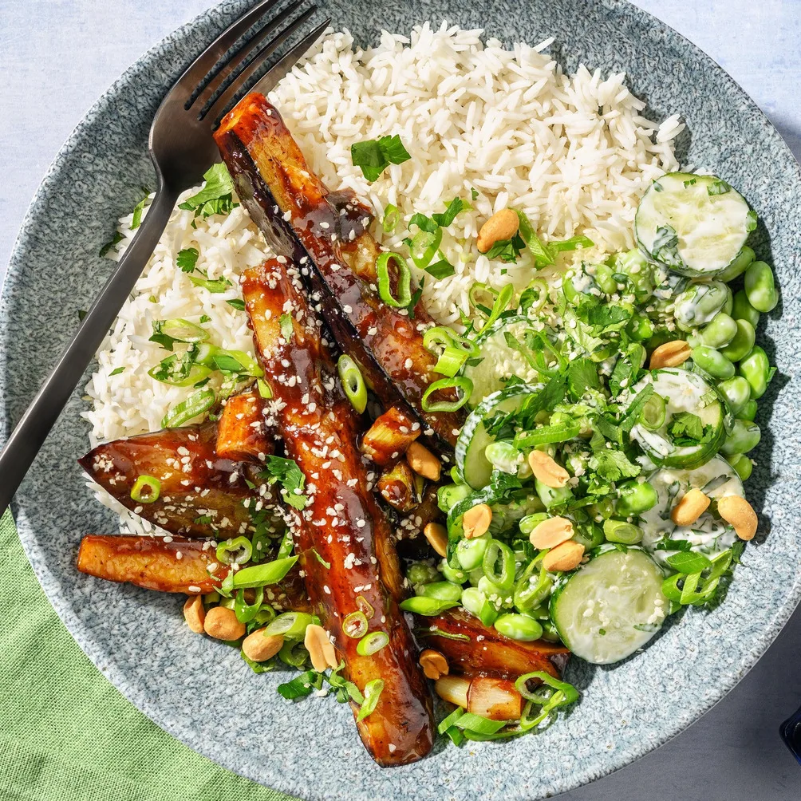
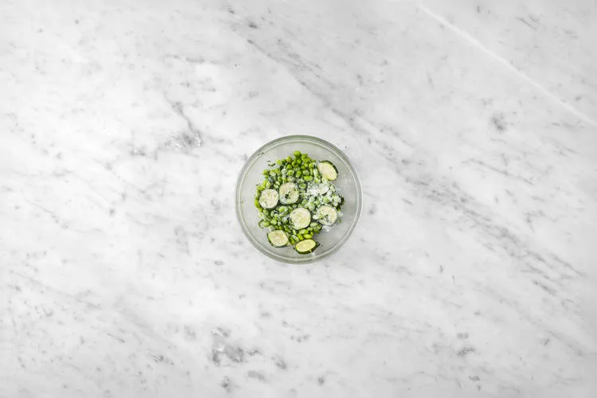
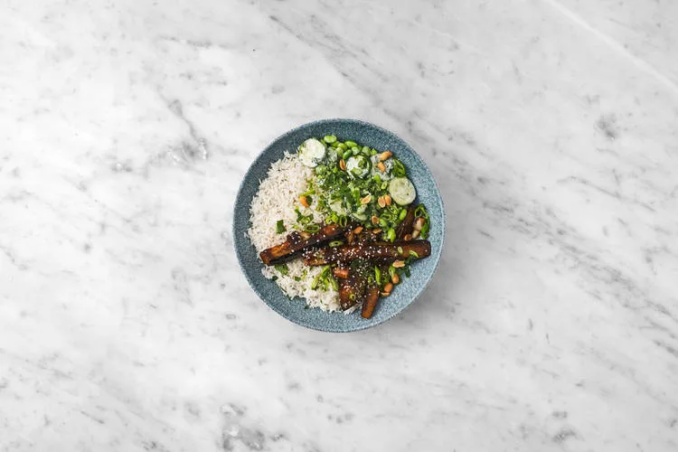

Aubergine en sauce hoisin et salade de fèves de soja au gomasio, riz à l'ail, cacahuètes, coriandre et oignon nouveau. Prêt en 25 minutes.

Originaires de Chine, les fèves de soja sont riches en protéines végétales mais aussi en nutriments essentiels, tels que le fer et le calcium. Une base nutritive et savoureuse à incorporer à vos repas !

## Ingrédients (2 personnes)
- 1 aubergine
- 1 bouquet d'oignon nouveau
- 50 gr sauce hoisin
- 35 gr sauce asiatique douce
- 100 gr fèves de soja
- 1/2 concombre
- 20 gr cacahuètes non salées
- 10 gr coriandre fraîche
- 1 gousse d'ail
- 150 gr riz long grain
- 1 sachet de gomasio
- 1 cuillère à soupe d'huile de tournesol
- 60 ml eau
- 2 cuillères à café de vinaigre de vin blanc
- 1 cuillère à soupe de mayonnaise [végétale]
- 1 cuillère à soupe de beurre [végétal]
- 2 cuillères à café de miel [ou alternative vegan]
- 360 ml bouillon de légumes à faible teneur en sel

## Préparation
1. Préparez le bouillon. Écrasez ou émincez l'ail. Faites fondre le beurre dans la casserole et revenir l'ail 1 à 2 minutes à feu doux. Ajoutez-y le riz puis le bouillon. Faites cuire le riz 12 à 15 minutes à couvert. Ensuite, retirez la casserole du feu et réservez 5 minutes. Égouttez le riz si nécessaire.

   

2. Coupez l'aubergine en deux dans la longueur, puis chaque moitié en 4 longs quarts. Émincez un peu de la partie verte de l'oignon nouveau puis réservez-la pour l'utiliser comme garniture plus tard. Coupez le reste de l'oignon nouveau en tronçons de 4 cm. Faites chauffer l'huile de tournesol dans la sauteuse à feu vif et cuire l'aubergine et les tronçons d'oignon nouveau 3 à 4 minutes. Retournez régulièrement.

   

3. Portez le feu sous la sauteuse sur moyen et ajoutez l'eau (voir tableau des ingrédients). Couvrez puis laissez mijoter 4 à 6 minutes. Pendant ce temps, coupez le concombre en rondelles et ciselez la coriandre. Dans le bol, mélangez le miel avec la mayonnaise et la moitié du vinaigre de vin blanc. Ajoutez-y le concombre, les fèves de soja et la moitié de la coriandre. Mélangez bien puis salez et poivrez à votre goût.

   

4. Déglacez l'aubergine avec le reste de vinaigre de vin blanc puis ajoutez la sauce hoisin et la sauce asiatique douce. Poursuivez la cuisson 1 minute. Servez le riz dans des grands bols et déposez-y l'aubergine et la salade. Garnissez la salade de gomasio et l'aubergine de l'oignon nouveau réservé, des cacahuètes et du reste de coriandre.

   

## Lien
[HelloFresh](https://www.hellofresh.be/recipes/extra-25-min-veggie-no-cheese-66deb60746f5f843647213ee?locale=fr-BE)
