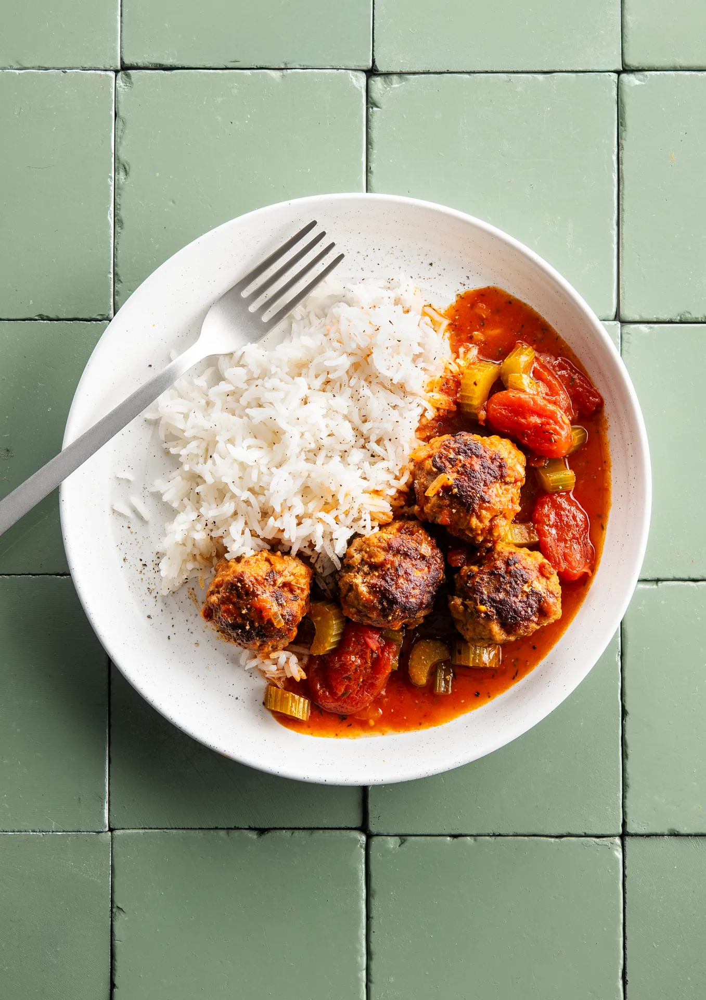

Boulettes à la sauce tomate, riz et tomates cerises. Prêt en 30 minutes.

## Ingrédients (2 personnes)
- 1/4 cube de bouillon de légumes
- 1/2 boîte de concentré de tomates
- 1 oignon jaune
- 1 gousse d'ail
- 300 gr viande hachée (porc/boeuf)
- 125 gr riz blanc basmati
- 100 gr céleri
- 350 gr tomates cerises rouges
- huile d'olive
- 1/2 càs d'herbes de Provence
- sel et poivre noir

## Préparation
1. Hachez finement l'oignon et pressez l'ail. Coupez le céleri en morceaux de 0,5 cm.

2. Mélangez la moitié de l'oignon dans la viande hachée. Salez, poivrez et roulez des boulettes de viande de la taille d'une balle de ping-pong (voir astuce). Chauffez un filet d'huile d'olive dans une grande poêle et faites dorer les boulettes à feu vif. Retirez-les ensuite de la poêle, elles continueront à cuire plus tard dans la sauce.

3. Chauffez un filet d'huile d'olive dans la même poêle et faites revenir le reste de l'oignon, l'ail et le concentré de tomates 2 min à feu doux. Ajoutez les tomates cerises et les morceaux de céleri. Ajoutez un filet d'eau et laissez mijoter environ 5 min.

4. Faites cuire le riz selon les instructions indiquées sur l'emballage.

5. Écrasez les tomates cerises avec une fourchette et ajoutez éventuellement un filet d'eau. Ajoutez les boulettes et laissez la sauce mijoter encore 5-7 min avec le couvercle sur la poêle. Émiettez le bouillon par-dessus et assaisonnez avec les herbes de Provence, du sel et du poivre noir.

6. Servez le riz avec les boulettes à la sauce tomate. Bon appétit !

## Astuce
Envie de boulettes plus relevées ? Ajoutez une pincée de piment de Cayenne ou quelques flocons de piment.

## Lien
[Foodbag](https://www.foodbag.be/fr/recept?dishId=a0MJv00000IF7ejMAD&weekDocId=W44Y2026)
