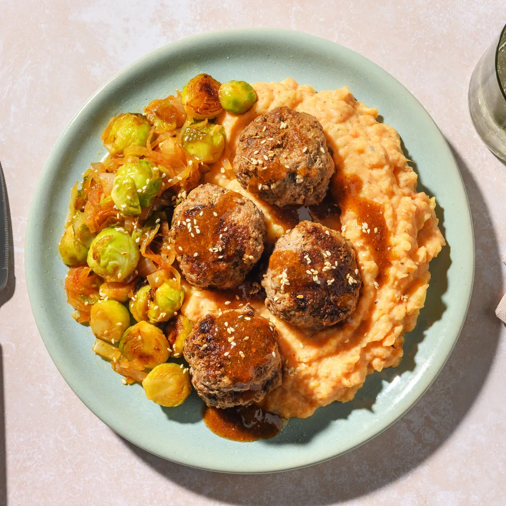
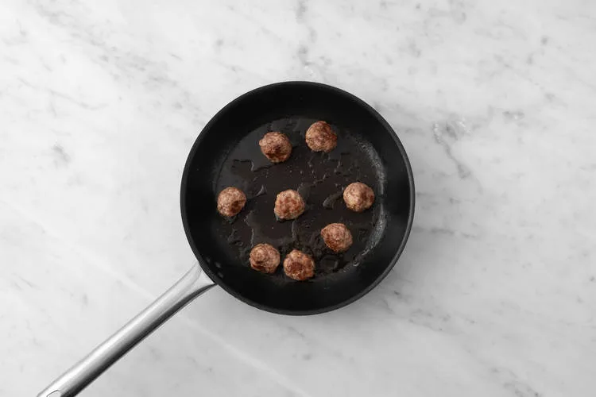
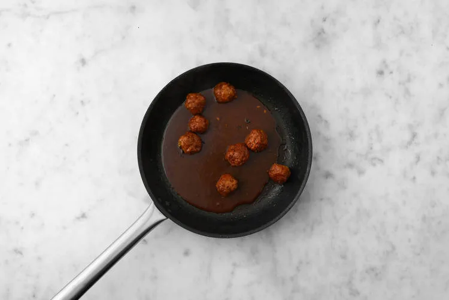
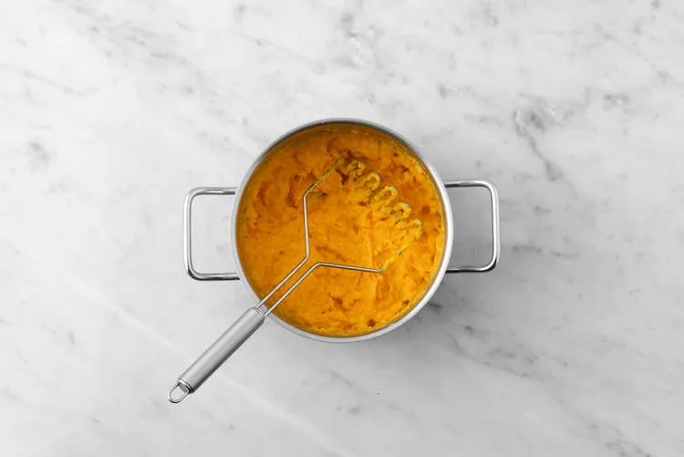
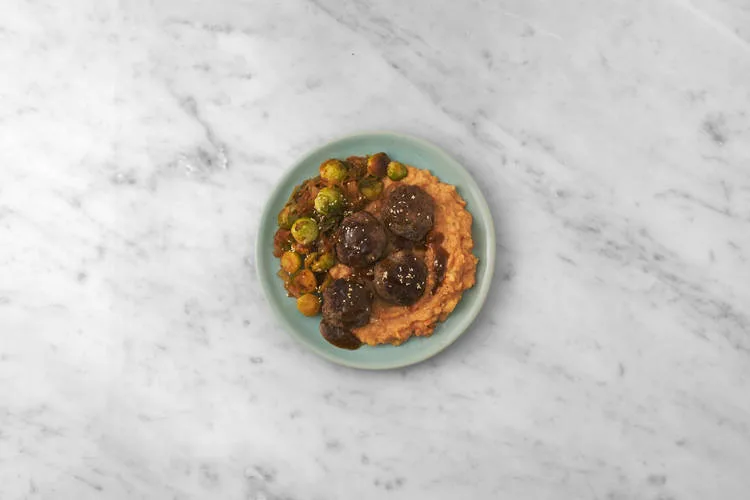

EXPLOSION SWICY ! Gochujang, chutney d'abricot & épices BBQ, savourez l'étonnant duo sucré-piquant de ces boulettes & choux de BXL ! Prêt en 30 minutes.

Nouveauté dans votre box : le chutney d'abricot offre une délicieuse combinaison de saveurs aigres-douces et d'accents épicés. Il intensifie le goût de vos currys, wraps et sautés.

## Ingrédients (2 personnes)
- 300 gr patate douce
- 1 sachet de mélange d’épices coréennes
- 300 gr choux de Bruxelles
- 1 oignon
- 10 ml huile de sésame
- 25 gr gochujang
- 50 gr chutney d'abricot
- 1 sachet d'épices pour BBQ
- 8 boulettes de bœuf et de porc
- 10 gr graines de sésame
- 400 gr pomme de terre
- 1 1/2 cuillère à soupe de beurre [végétal]
- 1 cuillère à soupe d'huile de tournesol
- 2 cuillères à soupe de miel [ou alternative vegan]
- 1 cuillère à café de farine
- lait [végétal]
- sauce rouge épicée [de type harissa]
- 200 ml bouillon de bœuf à faible teneur en sel

## Préparation
1. Épluchez ou lavez bien les pommes de terre et la patate douce, puis coupez-les en gros morceaux. Transférez-les dans une casserole et submergez-les dans de l'eau. Portez à ébullition et faites cuire 12 à 15 minutes. Ensuite, égouttez et réservez. Coupez l'oignon en demi-rondelles et les choux de Bruxelles en deux.

   

2. Faites chauffer 1 filet d'huile de tournesol dans un wok ou une sauteuse à feu moyen-vif. Faites-y cuire l'oignon et les choux de Bruxelles 4 à 6 minutes. Ajoutez-y l'huile de sésame, le gochujang (attention : ça pique ! Dosez-le selon votre goût.) et la moitié du miel. Faites cuire 2 à 3 minutes. Salez et poivrez à votre goût. Préparez le bouillon.

   

3. Faites fondre 1 petite noix de beurre dans une poêle à feu moyen-vif et cuire/dorer uniformément les boulettes de viande 2 à 3 minutes. Baissez le feu et poursuivez-en la cuisson 3 à 4 minutes à couvert. Portez le feu sur moyen-vif et incorporez la farine. Faites cuire 1 à 2 minutes, puis déglacez avec le bouillon.

   

4. Ajoutez-y le chutney aux abricots, les épices pour BBQ (attention : ça pique ! Dosez-les selon votre goût.) et le reste du miel. Mélangez bien, puis laissez mijoter 2 à 3 minutes, ou jusqu'à ce que la sauce ait réduit à votre convenance.

   

5. Écrasez les pommes de terre et la patate douce avec 1 noix de beurre, 1 filet de lait, puis incorporez-y les épices coréennes (voir conseil). Assaisonnez de sel et de poivre à votre goût. **Conseil :** *Pour encore plus de SWICY, ajoutez un peu de sauce rouge épicée (de type harissa) à votre convenance.*

   

6. Servez la purée et les autres ingrédients préparés sur les assiettes. Arrosez de sauce swicy à l'abricot et garnissez des graines de sésame.

   

## Lien
[HelloFresh](https://www.hellofresh.be/recipes/w50-bold-flavours-swicy-abrikozenchutney-694916363e57376810f97880?locale=fr-BE)
