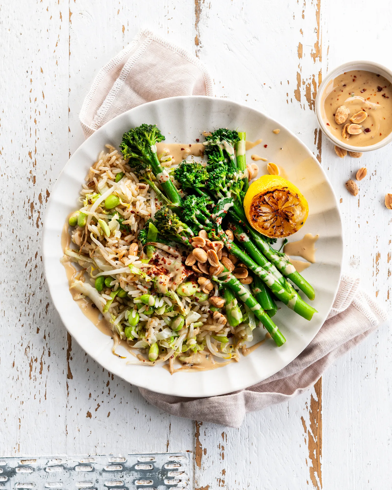

Broccolinis sauce cacahuète-sésame, edamame et riz sauté. Prêt en 35 minutes.

## Ingrédients (2 personnes)
- 1 gousse d'ail
- 200 gr broccolini
- 1 citron
- 25 gr cacahuètes
- 150 gr edamame
- 100 gr germes de soja
- 25 ml sauce soja
- 125 gr riz blanc basmati
- 1/2 sachet de beurre de cacahuète
- 20 gr tahini
- 150 gr chou blanc prédécoupé
- 1 càc de miel/sirop végétal
- huile
- flocons de chili (au goût)
- sel et poivre noir

## Préparation
1. Portez une grande casserole d’eau salée à ébullition. Faites blanchir les broccolinis pendant 2 min, puis retirez-les de l’eau.

2. Faites cuire ensuite les edamames pendant 3-5 min, jusqu'à ce que les cosses soient d'un vert éclatant. Égouttez, rincez à l’eau froide et écossez-les.

3. Faites cuire le riz selon les instructions figurant sur l'emballage dans la casserole des edamames. Rincez ensuite le riz à l’eau froide et égouttez soigneusement.

4. Faites dorer les cacahuètes dans une poêle sans matière grasse (voir astuce). Hachez-les grossièrement.

5. Coupez le citron en deux. Faites chauffer un filet d’huile dans une poêle et faites revenir les broccolinis et le citron avec le côté coupé vers le bas pendant 3-4 min à feu vif. Retournez régulièrement les broccolinis. Retirez-les de la poêle et réservez au chaud.

6. Sauce cacahuète-sésame : mélangez le beurre de cacahuète avec le tahini, la moitié de la sauce soja, l'édulcorant, les flocons de piment (facultatifs) et un filet de jus du citron rôti. Si nécessaire, ajoutez un filet d’eau pour obtenir une sauce plus liquide. Poivrez.

7. Pressez l’ail. Faites chauffer un généreux filet d'huile dans la poêle des broccolinis et ajoutez le riz, l'ail, le chou blanc et les germes de soja. Faites revenir 2-3 min à feu moyen. Assaisonnez avec le reste de la sauce soja et le poivre noir. Incorporez les fèves edamame.

8. Mettez le riz sur l’assiette. Disposez les broccolinis par-dessus. Arrosez de sauce cacahuète-sésame. Terminez avec les cacahuètes hachées et servez le citron rôti à côté. Bon appétit !

## Astuce
Utilisez une grande poêle. Vous pourrez également y faire cuire les broccolinis et le riz par la suite.

## Lien
[Foodbag](https://www.foodbag.be/fr/recept?dishId=a0MJv000004n7xJMAQ&weekDocId=W46Y2026)
