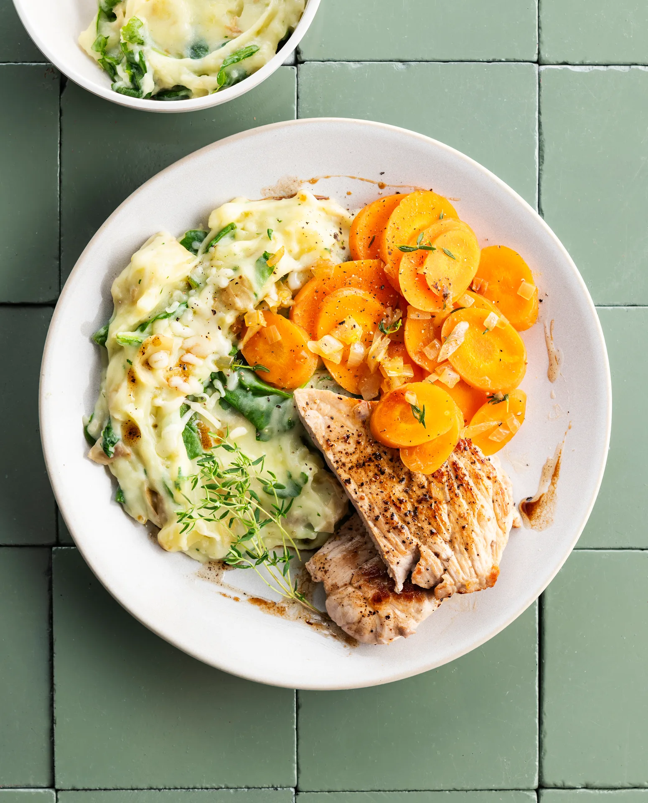

Escalope de porc, purée fromage-épinards et carottes étuvées. Prêt en 30 minutes.

## Ingrédients (2 personnes)
- 2 escalopes de porc
- 500 gr pommes de terre à chair farineuse
- 100 gr épinards
- 50 gr cheddar râpé
- 500 gr carottes
- 1 oignon jaune
- 1 plant de thym
- beurre
- 1 filet de lait
- 1 pincée de noix de muscade
- sel et poivre noir

## Préparation
1. Coupez les pommes de terre en morceaux de 3 cm environ (pas besoin d’éplucher). Couvrez-les d’eau dans une casserole avec une bonne pincée de sel et faites bouillir pendant 15-20 min. Ajoutez les épinards durant les 5 dernières minutes.

2. Coupez les carottes en rondelles de 2-3 mm (pas besoin d’éplucher). Hachez finement l’oignon.

3. Faites fondre une grosse noix de beurre dans une grande poêle. Faites revenir l'oignon pendant 1 min jusqu'à ce qu'il soit translucide. Ajoutez les carottes et le thym, et faites cuire pendant 3 min à feu moyen. Ajoutez un peu d'eau et laissez évaporer, jusqu'à ce que les carottes soient tendres. Salez et poivrez.

4. Pendant ce temps, faites fondre une noix de beurre dans une autre poêle. Assaisonnez les escalopes de porc de sel et de poivre noir, puis faites revenir pendant 2-3 min des deux côtés jusqu'à ce que la viande soit bien rosée. Vous préférez une viande un peu plus cuite ? Laissez une minute de plus dans la poêle.

5. Égouttez les pommes de terre et les épinards, puis ajoutez du lait avant d’écraser le tout en purée onctueuse. Ajoutez le cheddar, puis assaisonnez de noix de muscade, de sel et de poivre noir (voir astuce).

6. Vérifiez si les carottes sont cuites. Retirez le thym. Servez les escalopes de porc avec la purée au fromage et aux épinards, et les carottes étuvées. Bon appétit !

## Astuce
Envie de donner plus de profondeur à votre purée ? Ajoutez-y alors une cuillère de moutarde !

## Lien
[Foodbag](https://www.foodbag.be/fr/recept?dishId=a0MJv000003lCDiMAM&weekDocId=W44Y2026)
