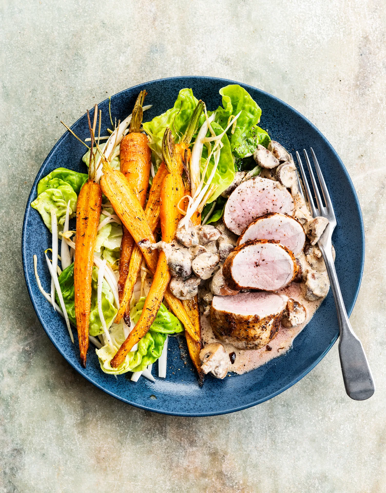

Filet de porc sauce aux champignons, jeunes carottes rôties et salade. Prêt en 30 minutes.

## Ingrédients (2 personnes)
- 300 gr filet de porc
- 125 gr champignons châtaigne
- 1 échalote
- 1 gousse d'ail
- 2/3 salade
- 1 chicon
- 1/2 botte de carottes
- 1 yaourt à la grecque
- huile d'olive
- 1 pincée de thym séché
- 1/2 càc de moutarde
- 1 filet de vinaigre balsamique
- papier sulfurisé
- sel et poivre noir

## Préparation
1. Préchauffez le four à 200 °C et recouvrez une plaque de cuisson de papier sulfurisé.

2. Coupez les champignons en 4. Les plus gros peuvent être coupés en 6. Hachez finement l’échalote et pressez l’ail.

3. Coupez les carottes en deux (pas besoin d’éplucher et vous pouvez laisser une partie des fanes). Sur la plaque de cuisson, mélangez avec l'huile d'olive, le sel, le poivre noir et le thym séché. Faites rôtir pendant 20-25 min au four.

4. Déchirez la salade en morceaux et coupez le chicon en fines lamelles (voir astuce). Assaisonnez d’un filet d’huile d’olive, de vinaigre balsamique, de sel et de poivre noir.

5. Faites chauffer un filet d'huile dans une poêle (résistante au four) à feu vif. Assaisonnez le filet de porc de sel et de poivre noir. Croutez les côtés. Transférez éventuellement la viande dans un plat à four et poursuivez la cuisson au four, en comptant environ 3 min par 100 grammes. Laissez ensuite la viande reposer sur votre planche pendant quelques minutes.

6. Faites à nouveau chauffer un filet d’huile d’olive dans la poêle de la viande. Faites revenir les champignons, l'échalote et l'ail jusqu'à ce que l'échalote soit translucide et les champignons colorés. Ajoutez la moutarde et assaisonnez de sel et de poivre noir. Retirez du feu et incorporez le yaourt.

7. Découpez la viande en tranches. Servez avec la sauce aux champignons, les carottes rôties et la salade. Bon appétit !

## Astuce
Vous préférez un chicon braisé ? Faites-le revenir avec les champignons dans la poêle.

## Lien
[Foodbag](https://www.foodbag.be/fr/recept?dishId=a0MJv000008lsefMAA&weekDocId=W38Y2026)
