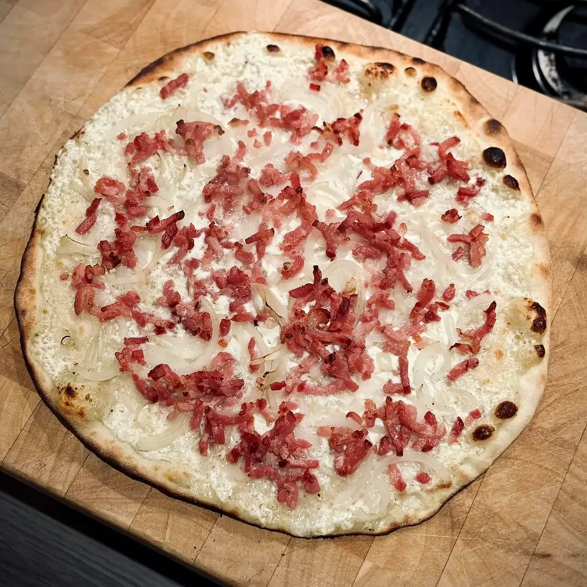

Une pâte fine et croustillante pour flammekueche, à **60 % d’hydratation**. Les quantités ci-dessous vont de 1 à 6 pâtons d’environ 200 g (hors huile).

## Lien

[YouTube](https://www.youtube.com/watch?v=BtDxYtwhYWI)

## Ingrédients

Pourcentages boulangers : **60 % d’eau**, **2,4 % de sel** et **0,28 % de levure boulangère sèche** par rapport au poids de la farine. Toutes les quantités du tableau sont en grammes.

| Pâtons | Farine | Eau | Sel | Levure sèche |
| ---: | ---: | ---: | ---: | ---: |
| 1 | 125 | 75 | 3 | 0,35 |
| 2 | 250 | 150 | 6 | 0,7 |
| 3 | 375 | 225 | 9 | 1,05 |
| 4 | 500 | 300 | 12 | 1,4 |
| 5 | 625 | 375 | 15 | 1,75 |
| 6 | 750 | 450 | 18 | 2,1 |

> Ajouter un petit filet d’**huile neutre** au pétrissage, jusqu’à ce que la pâte soit souple et ne colle plus.

## Préparation

1. **Mélanger et pétrir.** Mélanger la farine et la levure, puis verser l’eau froide du réfrigérateur petit à petit. Ajouter le sel et pétrir 8 à 10 minutes, jusqu’à ce que la pâte soit lisse et élastique. Ajouter un filet d’huile neutre en fin de pétrissage. La pâte ne doit pas dépasser **24 °C** pendant le pétrissage : si besoin, faites des pauses pour laisser le bol refroidir.

2. **Laisser reposer.** Couvrir et laisser reposer **30 minutes** à température ambiante avant d’abaisser la pâte.

3. **Former les pâtons.** Diviser la pâte en morceaux d’environ 200 g et bouler chaque morceau.

4. **Étaler.** Étaler chaque pâton très finement sur un plan de travail fariné, en gardant une forme ronde ou rectangulaire.

5. **Garnir et cuire.** Préchauffer le four au maximum (**250 à 270 °C**), avec la plaque ou la pierre à pizza. Garnir la pâte et cuire 8 à 10 minutes, jusqu’à ce que les bords soient dorés et croustillants.

## Garniture

- **Crème** : crème fraîche épaisse (ou fromage blanc), muscade et poivre.
- **Oignons** : émincés finement.
- **Lardons** : fumés, légèrement revenus à la poêle.

## Astuce

- **Pour que la crème tienne**, ajouter de la **fécule de maïs** à la crème : environ **1 cuillère à café pour 200 g de crème**. Mélanger à froid avant d’étaler, la crème épaissit à la cuisson et ne détrempe pas la pâte.
- Étaler la pâte le plus finement possible : c’est ce qui donne le croustillant caractéristique de la flammekueche.
- Ne pas trop charger la garniture, sinon la pâte ramollit.
- Les pâtons se congèlent très bien après la division : les laisser décongeler au réfrigérateur avant de les étaler.
