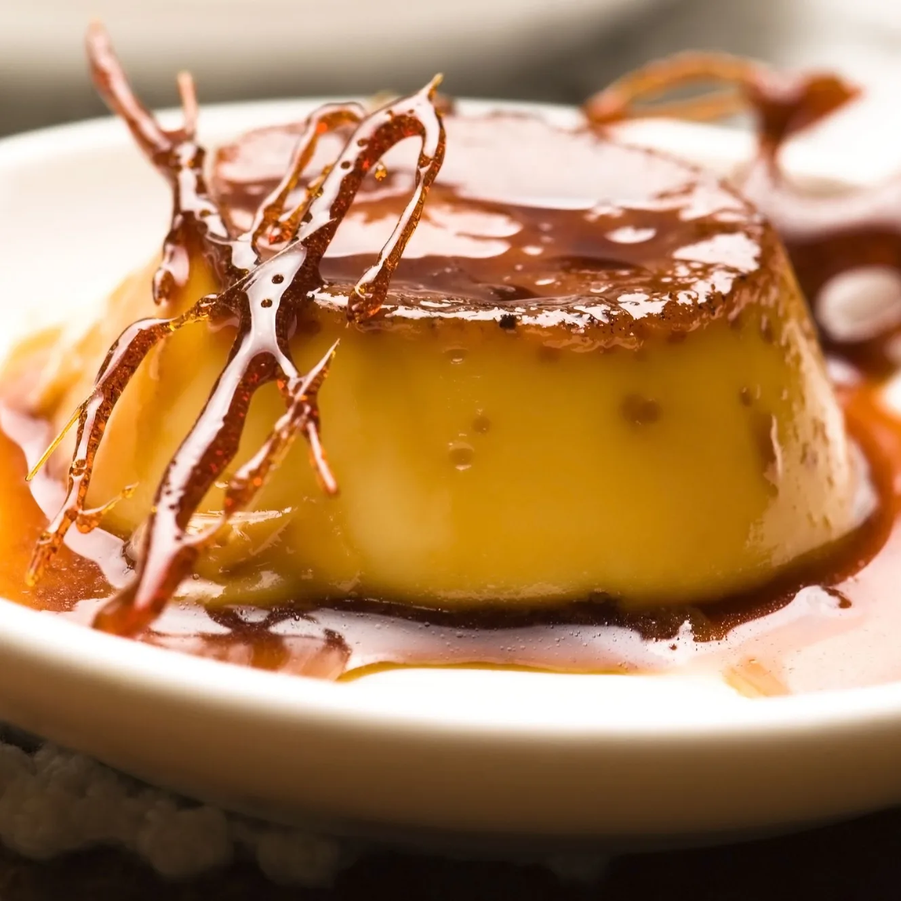

Flan au caramel fait maison facile. Prêt en 1 h 20.

## Ingrédients (6 personnes)
- 6 œufs
- 250 g de sucre
- 1 l de lait
- 1 cuillère à soupe de rhum
- 1 gousse de vanille
- 5 cl d'eau

## Préparation
1. Préchauffez le four à 180 °C (th. 6). Dans une casserole à feu doux, versez 5 cl d'eau puis 150 g de sucre. Laissez bouillir jusqu'à obtenir un caramel. Versez-le dans un moule ou des ramequins.

2. Dans une autre casserole, versez le lait. Ajoutez la gousse de vanille fendue en 2 dans le sens de la longueur. Laissez tiédir le lait à feu très doux.

3. Dans un bol, fouettez les œufs avec les 100 g de sucre restant. Ajoutez le lait, puis 1 cuillère à soupe de rhum. Mélangez à nouveau. Versez la crème obtenue sur le caramel.

4. Dans un grand plat à four, versez de l'eau puis posez-y le moule ou les ramequins. Enfournez pendant 1 h pour une cuisson au bain-marie. À la fin de la cuisson, laissez refroidir. Servez.

## Astuce

- **Peut-on remplacer le rhum dans la recette ?** Oui, le rhum peut être omis ou remplacé par de l'extrait de vanille ou d'amande pour parfumer différemment le flan.
- **Comment éviter que le caramel ne cristallise ?** Évitez de remuer le sucre en chauffant ; inclinez simplement la casserole pour mélanger. Vous pouvez ajouter une petite quantité de jus de citron pour prévenir la cristallisation.
- **Comment savoir si le flan est bien cuit ?** Insérez une lame de couteau au centre du flan ; elle doit ressortir propre. Le flan doit être encore légèrement tremblotant au milieu, il continuera à se figer en refroidissant.
- **Peut-on faire le flan sans four ?** Oui, il est possible de cuire le flan au bain-marie sur le feu ou dans une cocotte-minute. Le temps de cuisson peut varier.
- **Combien de temps peut-on conserver le flan au caramel ?** Le flan peut se conserver au réfrigérateur pendant 2 à 3 jours. Assurez-vous qu'il soit bien couvert pour éviter qu'il n'absorbe les odeurs.

## Lien
[CuisineAZ](https://www.cuisineaz.com/recettes/flan-au-caramel-fait-maison-facile-79642.aspx)
