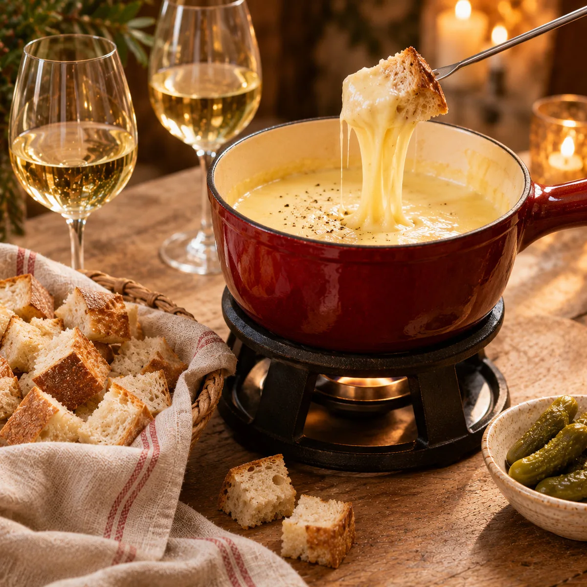

La fondue savoyarde traditionnelle, au Comté, à l'Abondance et à l'Appenzeller, parfumée à l'ail, au kirsch et à la muscade. Un plat convivial à partager autour d'un caquelon fumant, avec du pain de campagne.

## Ingrédients (4 personnes)
- 250 g de Comté
- 250 g d'Abondance
- 250 g d'Appenzeller
- 2,5 dl de vin blanc sec (Valais)
- 3 cuillères à café de fécule de maïs
- 2 gousses d'ail
- 1/3 cl de kirsch (facultatif)
- noix de muscade
- poivre du moulin
- 1 pain de campagne ou une baguette légèrement rassie

## Préparation
1. **Parfumer le caquelon.** Coupez les gousses d'ail en deux et frottez l'intérieur du caquelon avec la face coupée, afin de le parfumer délicatement.

2. **Chauffer le vin blanc.** Versez le vin dans le caquelon et faites-le chauffer à feu doux, sans jamais le porter à ébullition.

3. **Incorporer les fromages.** Ajoutez les fromages finement râpés progressivement, en remuant constamment à la cuillère en bois et en formant des « 8 » pour obtenir une fonte homogène.

4. **Lier la fondue.** Délayez la fécule de maïs dans un peu de vin blanc froid ou d'eau froide, puis incorporez-la au mélange. Ajoutez le kirsch si vous le souhaitez.

5. **Assaisonner et servir.** Poivrez, ajoutez une pincée de muscade et servez immédiatement sur un réchaud à feu doux, avec le pain coupé en cubes.

## Astuce
- Râpez finement les fromages : ils fondent plus facilement et donnent une texture plus homogène.
- Ne faites jamais bouillir la fondue : une chaleur trop forte rend le fromage granuleux.
- Remuez en continu pour éviter que le fromage n'attache au fond du caquelon.
- Utilisez un vin blanc sec et acide, indispensable pour une bonne émulsion.
- Si la fondue est trop épaisse, ajoutez un peu de vin blanc chaud ; si elle est trop liquide, ajoutez un peu de fromage râpé.
- Comptez environ 200 à 250 g de fromage par personne.
- Préparez la fondue idéalement au dernier moment ; elle peut être réchauffée doucement en remuant.

## Accompagnement
- Pommes de terre vapeur
- Cornichons et oignons au vinaigre
- Salade verte pour plus de fraîcheur

## Lien
[Les Secrets du Chef](https://www.lessecretsduchef.be/fr/blog/veritable-fondue-savoyarde-n92)
