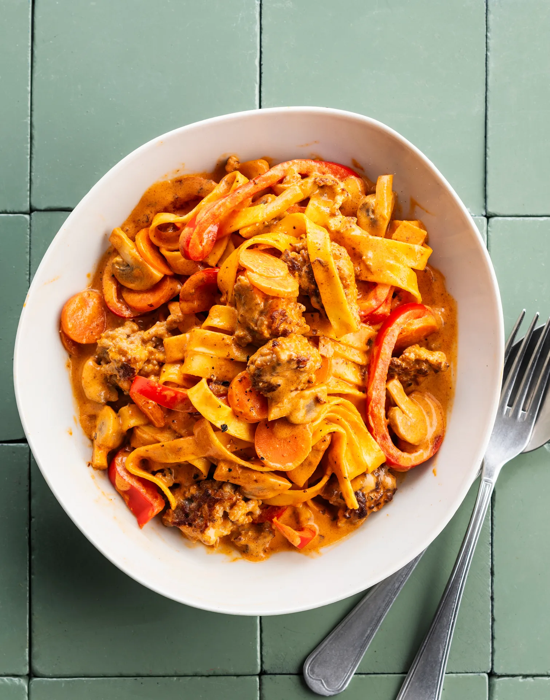

Haché Stroganoff et pâtes fraîches, carotte, poivron et champignons. Prêt en 30 minutes.

## Ingrédients (2 personnes)
- 1/4 cube de bouillon de boeuf
- 300 gr viande hachée (porc/boeuf)
- 250 gr tagliatelles fraîches
- 1 carotte
- 125 gr champignons blancs
- 1/4 petit pot de crème épaisse
- 1/4 sachet de paprika fumé en poudre
- 1/2 boîte de concentré de tomates
- 1 poivron rouge
- huile
- sel et poivre noir

## Préparation
1. Portez une grande casserole d’eau salée à ébullition pour les pâtes (voir astuce).

2. Coupez le poivron en lamelles, la carotte en tranches de 0,5 cm (pas besoin d’éplucher) et les champignons en 4. Les plus gros peuvent être coupés en 6.

3. Faites chauffer un filet d’huile dans une poêle (wok) et faites cuire la viande hachée jusqu’à ce qu’elle se détache en l’écrasant en morceaux à l’aide d’une fourchette ou d’une spatule. Ne mélangez pas trop pour qu'elle devienne croustillante.

4. Sauce Stroganoff : retirez la viande hachée de la poêle et faites chauffer un autre filet d'huile. Faites cuire les lamelles de poivron, les tranches de carotte et les champignons pendant 5-8 min à feu moyen. Ajoutez ensuite le paprika fumé en poudre, la crème fraîche, le concentré de tomates et 75 ml d'eau par personne. Émiettez-y le bouillon. Laissez mijoter 5 min à feu moyen. Assaisonnez de sel et de poivre noir.

5. Faites cuire les pâtes pendant environ 2 min jusqu’à ce qu’elles soient al dente.

6. Incorporez la viande hachée à la sauce et laissez chauffer quelques instants. Goûtez et assaisonnez de sel et de poivre noir.

7. Servez la sauce Stroganoff avec les pâtes. Bon appétit !

## Astuce
Utilisez une bouilloire électrique pour obtenir de l'eau chaude très rapidement.

## Lien
[Foodbag](https://www.foodbag.be/fr/recept?dishId=a0MJv0000074uIvMAI&weekDocId=W30Y2026)
