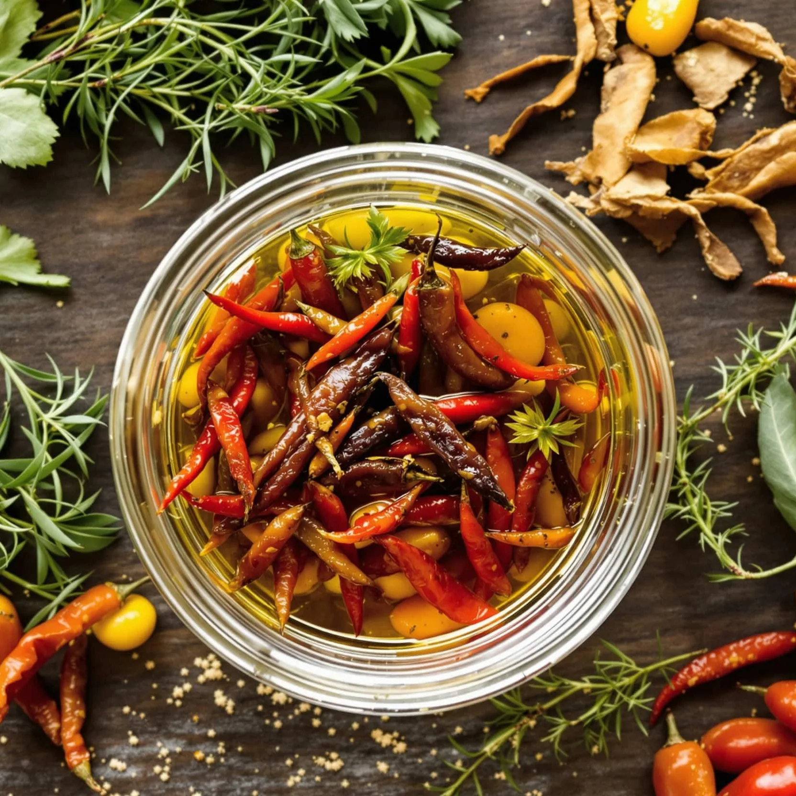

Huile Piquante Pizza. Prêt en 20 minutes, puis 48 h d'infusion.

## Ingrédients (4 personnes)
- 50 cl d’huile d’olive vierge extra
- 10 à 15 piments oiseaux séchés
- 1 feuille de laurier
- 4 branches de thym frais
- 2 cuillères à café de baies roses
- 1 gousse d’ail pressée (facultatif)
- quelques grains de poivre noir (facultatif)
- flocons de piment (facultatif)

## Préparation
1. **Rassemblez tous les ingrédients.** Prenez une casserole de taille moyenne et versez-y les 50 cl d’huile d’olive. Ajoutez ensuite la feuille de laurier, les piments oiseaux séchés, les branches de thym, les baies roses et la gousse d’ail pressée si vous avez opté pour cette option. Si vous souhaitez un piquant supplémentaire, ajoutez également quelques grains de poivre noir et une pincée de flocons de piment. L’avantage de cette recette, c’est que tout se prépare en une seule fois.

2. **Chauffez l’huile en douceur.** Placez la casserole sur feu très doux. L’objectif n’est pas de faire cuire les ingrédients, mais de chauffer l’huile suffisamment pour que les arômes commencent à s’en échapper. Laissez chauffer pendant 5 à 10 minutes en surveillant attentivement. L’huile ne doit jamais bouillir ni fumer. Vous devez voir quelques petites bulles se former autour des herbes et des piments, signe que l’infusion commence. Si vous possédez un thermomètre de cuisine, maintenez la température autour de 60-70 °C maximum. Cette étape délicate permet aux saveurs de se diffuser sans brûler les aromates, ce qui donnerait une amertume désagréable.

3. **Laissez refroidir complètement.** Retirez la casserole du feu et laissez l’huile refroidir naturellement à température ambiante. Ne soyez pas tenté de transférer l’huile immédiatement : le processus de refroidissement fait partie de l’infusion. Pendant que l’huile tiédit, les ingrédients continuent de libérer leurs composés aromatiques. Comptez environ 1 à 2 heures pour un refroidissement complet. Vous pouvez remuer délicatement de temps en temps pour favoriser la distribution des arômes.

4. **Conditionnez votre huile.** Une fois l’huile totalement refroidie, munissez-vous d’une bouteille en verre propre et sèche, idéalement avec un bouchon hermétique. Utilisez un entonnoir pour transférer l’huile sans en perdre. Voici un point important : **laissez les piments, les herbes et les épices dans la bouteille**. Ils continueront d’infuser l’huile et renforceront le goût au fil des jours. Si l’esthétique vous importe, vous pouvez utiliser une jolie bouteille transparente : l’aspect visuel avec les piments et les herbes suspendus dans l’huile dorée est vraiment appétissant.

5. **Période de repos indispensable.** Cette étape est celle qui demande le plus de patience, mais elle est absolument nécessaire. Placez votre bouteille dans un endroit frais, sec et à l’abri de la lumière directe. Oubliez-la pendant **48 heures minimum**. L’idéal ? Laissez infuser 3 à 5 jours avant la première utilisation. Les saveurs vont se développer, s’harmoniser et gagner en intensité. Si vous pouvez patienter jusqu’à deux semaines, vous obtiendrez une huile encore plus puissante et complexe. Secouez légèrement la bouteille tous les deux jours pour remuer les ingrédients et favoriser l’infusion.

## Astuce

- **Conseil qualité :** Privilégiez les piments oiseaux entiers séchés plutôt que les flocons. Ils libèrent leurs arômes progressivement et donnent un goût plus rond, moins agressif. Vous les trouverez facilement en épicerie asiatique ou au rayon monde des supermarchés.
- **Conservation :** Votre huile se conserve plusieurs mois (3 à 6 mois minimum) si vous respectez les conditions : récipient hermétique, endroit frais et sombre. Évitez le réfrigérateur qui figerait l’huile d’olive et ralentirait l’infusion. Un placard de cuisine éloigné des sources de chaleur convient parfaitement.
- Commencez toujours par une petite quantité : cette huile est puissante. Vous pourrez toujours en rajouter, mais impossible de revenir en arrière.
- Servez-la à table dans une petite bouteille ou un ramequin pour que chacun dose selon ses préférences.
- Si vous trouvez l’huile trop épicée après quelques semaines d’infusion, diluez-la simplement avec de l’huile d’olive neutre.
- N’hésitez pas à préparer plusieurs versions : une très piquante pour les amateurs, une plus douce pour les palais sensibles.

## Lien
[Delicha](https://www.delicha.fr/huile-piquante-pizza-la-bonne-recette.html)
