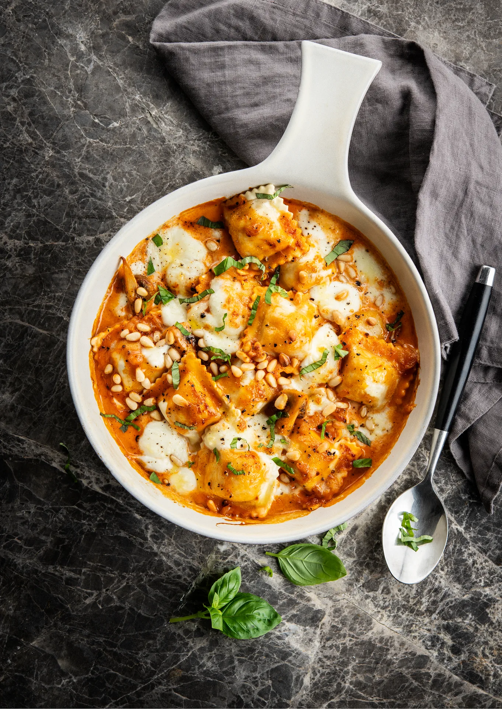

Lasagne de raviolis aux oignons caramélisés, mozzarella et champignons. Prêt en 25 minutes.

## Ingrédients (2 personnes)
- 16 raviolis frais enigma
- 2 oignons jaunes
- 250 gr champignons blancs
- 150 ml crème (20% mg)
- 1 boule de mozzarella
- 1/2 boîte de concentré de tomates
- 1 paquet de basilic
- 15 gr pignons de pin
- 1 gousse d'ail
- beurre
- huile d'olive
- 1 pincée d'origan séché
- 1 càc de sucre brun
- sel et poivre noir

## Préparation
1. Coupez les oignons en rondelles. Faites fondre une noix de beurre et un filet d'huile d'olive dans une casserole à feu moyen et laissez suer les rondelles d'oignon pendant 10 min. Assaisonnez avec du sucre (brun), de l'origan, du sel et du poivre noir.

2. Pendant ce temps, préchauffez le four à 200°C.

3. Coupez les champignons en 4 ou en 6, pressez l'ail et faites-les mijoter avec les rondelles d'oignon (voir astuce). Ajoutez également le concentré de tomates et laissez cuire quelques minutes.

4. Déglacez les oignons et les champignons avec la crème et remuez bien. Disposez les raviolis dans un plat à four et arrosez-les de sauce. Déchirez la mozzarella en morceaux et disposez-les par-dessus. Terminez avec les pignons de pin et enfournez pendant 5-10 min, jusqu'à ce que la mozzarella soit fondue.

5. Hachez le basilic finement et terminez de garnir le plat avec. Bon appétit !

## Astuce
Les champignons absorbent naturellement beaucoup d'humidité. Ajoutez si besoin un peu de beurre ou un trait d'eau pour que tout cuise bien sans attacher.

Faites précuire les raviolis 1 à 2 min dans de l'eau bouillante salée avant de les disposer dans le plat : au four, ils resteraient fermes.

Épongez la mozzarella avec du papier absorbant avant de la déchirer : elle rendrait trop d'eau à la cuisson.

Les raviolis frais « enigma » peuvent être remplacés par des raviolis à la ricotta.

## Lien
[Foodbag](https://www.foodbag.be/fr/recept?dishId=a0MJv00000IGbKbMAL&weekDocId=W44Y2026)
