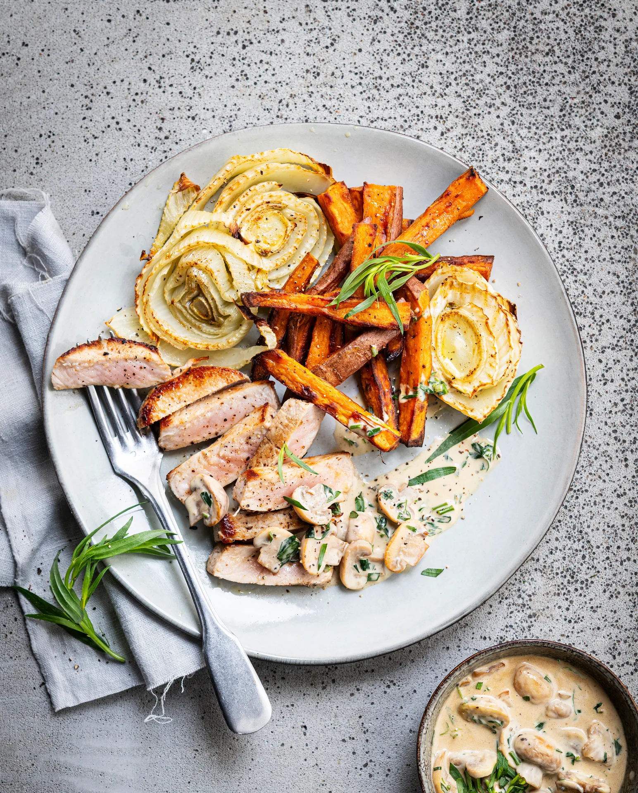

Mignonnette sauce estragon-champignons, fenouil et frites de patate douce. Prêt en 35 minutes.

## Ingrédients (2 personnes)
- 1 fenouil
- 400 gr patate douce
- 1 gousse d'ail
- 125 gr champignons blancs
- 2 mignonettes de porc
- 100 ml crème (20% mg)
- 1/2 plant d'estragon
- papier sulfurisé
- huile
- beurre
- sel et poivre noir

## Préparation
1. Préchauffez le four à 200 °C et recouvrez une plaque de cuisson de papier sulfurisé.

2. Coupez les patates douces en frites (pas besoin d’éplucher). Coupez le fenouil en tranches de 0,5 cm. Mélangez les frites et les tranches de fenouil sur la plaque de cuisson avec un peu d’huile. Faites rôtir pendant 20-25 min au four. Retournez à mi-cuisson. Sortez du four et assaisonnez de sel et de poivre noir.

3. Coupez les champignons en tranches. Pressez l’ail. Détachez les feuilles des brins d’estragon et hachez grossièrement.

4. Faites fondre une noix de beurre dans une poêle à feu vif. Assaisonnez les mignonnettes de porc de sel et de poivre noir. Faites revenir pendant 2-3 min des deux côtés, jusqu’à ce que la viande soit bien rosée. Vous préférez une viande un peu plus cuite ? Laissez une minute de plus dans la poêle. Retirez de la poêle et laissez reposer.

5. Faites fondre une autre noix de beurre dans la poêle des mignonnettes de porc. Faites dorer les champignons à feu moyen (voir astuce). Ajoutez la crème et les trois quarts de l’estragon haché. Laissez mijoter 2-3 min de plus. Salez et poivrez.

6. Coupez les mignonnettes en tranches. Servez avec les frites de patate douce, les tranches de fenouil et la sauce aux champignons. Garnissez avec le reste de l’estragon. Bon appétit !

## Astuce
Envie de relever la sauce aux champignons ? Une fois les champignons bien dorés, ajoutez une petite rasade de cognac ou de whisky. Laissez l’alcool s’évaporer ou flambez-le. Bien entendu, la prudence s’impose.

## Lien
[Foodbag](https://www.foodbag.be/fr/recept?dishId=a0MJv0000091TqnMAE&weekDocId=W36Y2026)
