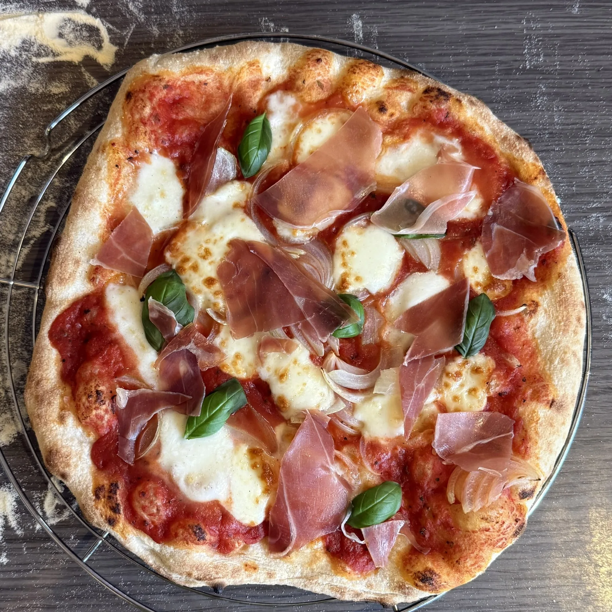

Une pâte à pizza souple et alvéolée, à 65 % d’hydratation. Les quantités ci-dessous vont de 1 à 6 pâtons d’environ 267 g.

## Ingrédients

Pourcentages boulangers : **65 % d’eau**, **3 % de sel** et **0,25 % de levure sèche** par rapport au poids de la farine. Toutes les quantités du tableau sont en grammes.

**Farine** : utiliser une farine contenant au moins **14 g de protéines pour 100 g**, par exemple la **Caputo Manitoba Oro**.

| Pâtons | Farine | Eau | Sel | Levure sèche |
| ---: | ---: | ---: | ---: | ---: |
| 1 | 159 | 103 | 5 | 0,4 |
| 2 | 317 | 206 | 9 | 0,8 |
| 3 | 476 | 310 | 14 | 1,2 |
| 4 | 635 | 413 | 19 | 1,6 |
| 5 | 793 | 516 | 23 | 2 |
| 6 | 952 | 619 | 28 | 2,4 |

> La recette de base pour 6 pâtons utilise 952 g de farine, 619 g d’eau, 28 g de sel et 2,38 g de levure boulangère sèche. Les valeurs du tableau sont arrondies.

## Préparation

1. **Mélanger et pétrir.** Dans le bol du pétrin, mélanger la farine et la levure. Verser l’eau froide du réfrigérateur petit à petit et mélanger jusqu’à ce qu’il ne reste plus de farine sèche. Ajouter le sel et pétrir 8 à 10 minutes, jusqu’à ce que la pâte soit lisse, souple et élastique. La pâte ne doit pas dépasser **24 °C** pendant le pétrissage : si besoin, faites des pauses pour laisser le bol refroidir.

2. **Laisser lever.** Couvrir le bol et laisser lever 1 h 30 à 2 h à température ambiante, jusqu’à ce que la pâte ait doublé de volume.

3. **Former les pâtons.** Diviser la pâte en morceaux d’environ 267 g. Bouler chaque morceau en serrant bien la surface.

4. **Laisser reposer.** Couvrir et laisser reposer 1 h à température ambiante. Pour plus de goût, placer les boules 24 à 72 h au réfrigérateur. Les sortir ensuite et attendre qu’elles atteignent **19 °C** avant de les étaler.

5. **Étaler et cuire.** Préchauffer le four avec la sole à **300 °C** et la voûte à **450 °C**. Étaler chaque pâton finement, garnir et cuire 1 à 2 minutes, en tournant la pizza régulièrement, jusqu’à ce que la croûte soit dorée et le dessus bien cuit.

## Sauce tomate

Ajouter **1 % de sel** par rapport au poids de la sauce tomate, soit **10 g de sel pour 1 kg** de sauce.

## Fromages

- Provolone
- Mozzarella
- Scamorza
- Gorgonzola

## Astuce

- Un peu de farine d’épeautre peut être ajoutée à la farine de blé pour apporter du goût.
- Une pâte trop collante se travaille avec un peu de farine sur le plan de travail, pas sur la pâte elle-même.
- La fermentation lente au réfrigérateur donne une pâte plus digeste et plus savoureuse.
- Les pâtons se congèlent très bien après la division : les laisser décongeler au réfrigérateur, puis attendre qu’ils atteignent 19 °C avant de les étaler.
