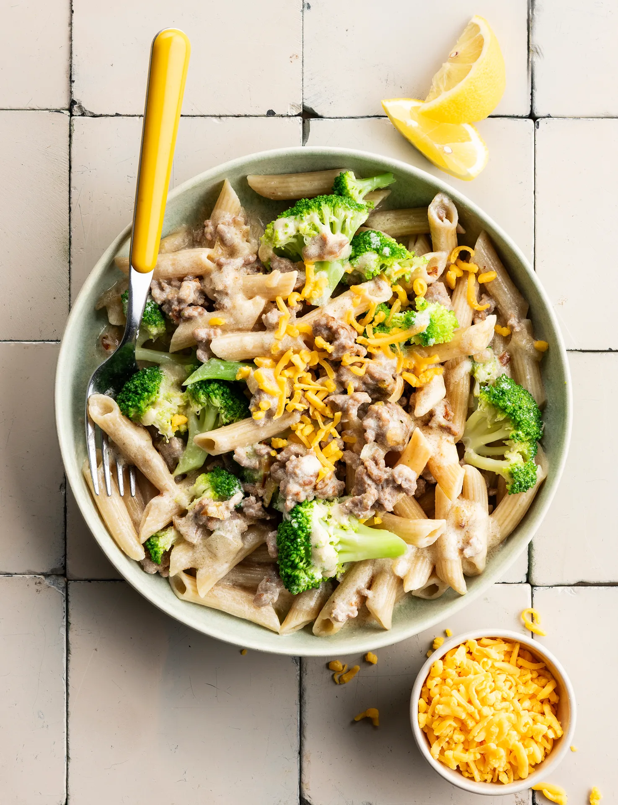

Pâtes au brocoli et à la viande hachée, sauce à la crème. Prêt en 25 minutes.

## Ingrédients (2 personnes)
- 200 gr pennes semi-complètes
- 50 gr cheddar râpé
- 1 gros brocoli
- 1 oignon jaune
- 1/2 citron
- 1/4 cube de bouillon de légumes
- 300 gr viande hachée (porc/boeuf)
- 1 gousse d'ail
- 150 ml crème (20% mg)
- huile d'olive
- 1/2 càs d'herbes de Provence
- sel et poivre noir

## Préparation
1. Portez une grande casserole d'eau salée à ébullition pour les pâtes et le brocoli.

2. Hachez finement l'oignon et pressez l'ail. Divisez le brocoli en bouquets.

3. Faites cuire les pâtes selon les instructions indiquées sur l'emballage. Ajoutez les bouquets de brocoli lors des 5 dernières min. Ensuite, égouttez, mais conservez une petite tasse d'eau de cuisson.

4. Pendant ce temps, chauffez un filet d'huile d'olive dans une poêle (wok) et faites revenir l'oignon et l'ail pendant environ 2 min. Ajoutez ensuite la viande hachée et faites-la cuire en l'écrasant en morceaux avec une fourchette ou une spatule. Ne remuez pas trop pour qu'elle devienne croustillante. Salez et poivrez.

5. Coupez le citron en quartiers (voir astuce).

6. Ajoutez les pâtes et les bouquets de brocoli à la viande hachée. Versez la crème par-dessus et émiettez-y le bouillon. Ajoutez éventuellement un peu d'eau de cuisson. Laissez mijoter pendant 5 min. Goûtez et assaisonnez avec les herbes de Provence, du sel et du poivre noir.

7. Servez les pâtes et garnissez d'un peu de cheddar et un quartier de citron. Bon appétit !

## Astuce
Frottez bien le citron et râpez le zeste. Vous pourrez le rajouter à la sauce selon votre goût.

## Lien
[Foodbag](https://www.foodbag.be/fr/recept?dishId=a0MJv00000GuJ6nMAF&weekDocId=W34Y2026)
