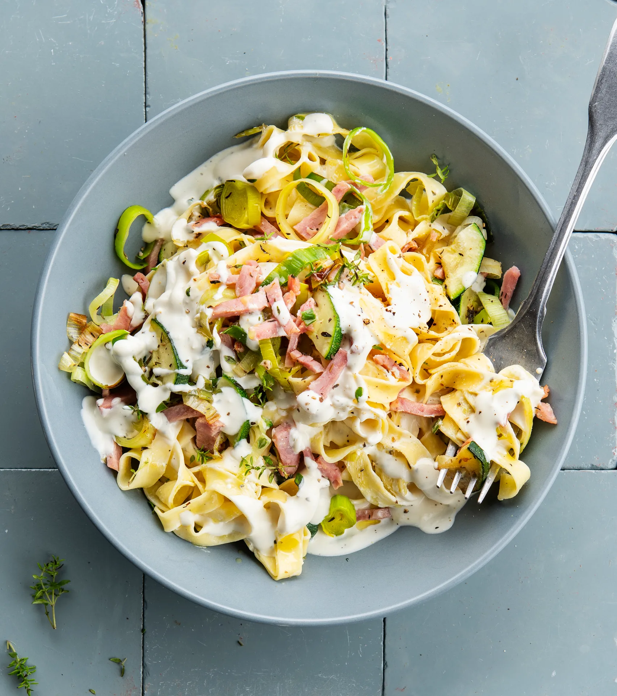

Pâtes fraîches au fromage frais aux herbes, poireau, courgette et dés de jambon. Prêt en 20 minutes.

## Ingrédients (2 personnes)
- 250 gr tagliatelles fraîches
- 1 poireau
- 1 courgette
- 100 gr émincés de jambon
- 150 gr fromage frais aux herbes
- 1/3 paquet de thym
- huile d'olive
- sel et poivre noir

## Préparation
1. Portez une casserole d’eau salée à ébullition pour les pâtes.

2. Coupez le poireau en rondelles. Coupez la courgette en 4 dans le sens de la longueur, puis en tranches de 0,5 cm. Effeuillez les brins de thym.

3. Faites chauffer un filet d’huile d’olive dans une grande poêle, puis faites revenir les rondelles de poireau, les tranches de courgette et le thym pendant 8-10 min à feu moyen. Salez et poivrez.

4. Pendant ce temps, faites cuire les pâtes al dente. Égouttez, mais conservez un peu d'eau de cuisson.

5. Remettez les pâtes dans la casserole et mélangez-les avec le fromage frais aux herbes, les légumes étuvés et les lanières de jambon. Ajoutez un peu d'eau de cuisson des pâtes pour obtenir une sauce onctueuse (voir astuce). Salez, poivrez, et servez dans une assiette creuse. Bon appétit !

## Astuce
Le fromage frais aux herbes, mélangé au jus de cuisson des pâtes, donne une délicieuse sauce. Veillez à utiliser suffisamment d'eau de cuisson : comptez au moins 50 ml par personne.

## Lien
[Foodbag](https://www.foodbag.be/fr/recept?dishId=a0MJv00000DuDxZMAV&weekDocId=W40Y2026)
