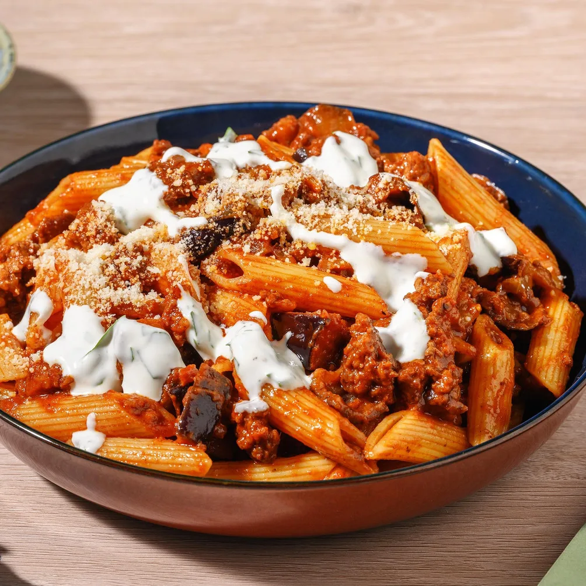
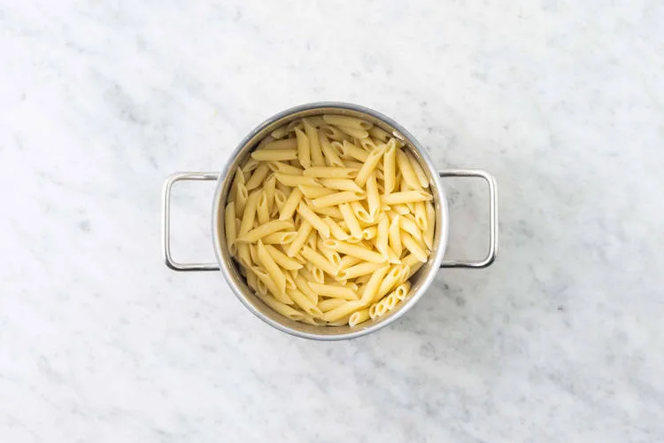
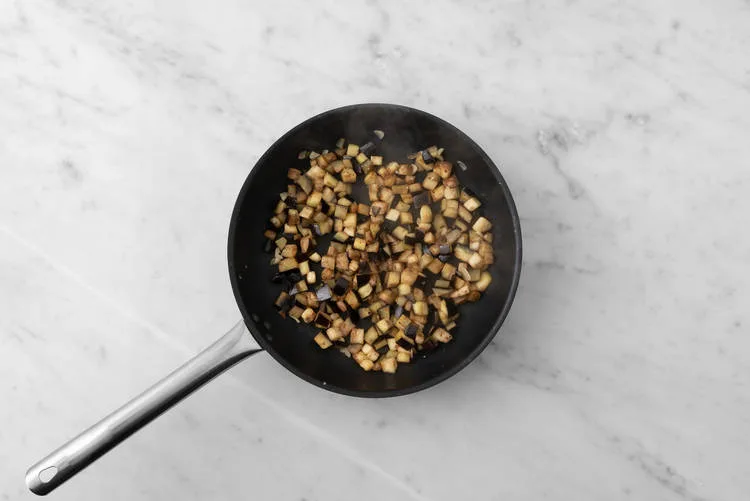
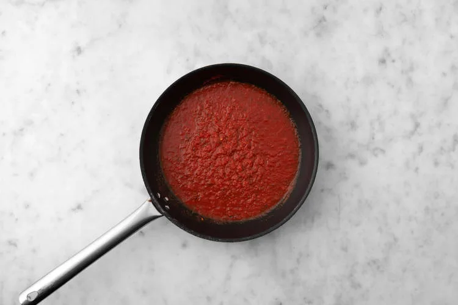
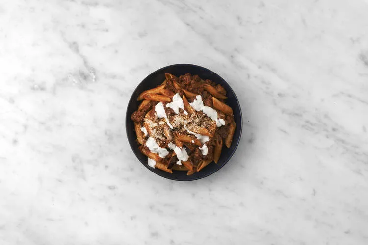

Penne au bœuf et sauce persillée au yaourt, aubergine, Parmigiano Reggiano et épices du Moyen-Orient. Prêt en 30 minutes.

Le mot « penne » vient de l'italien « penna », qui signifie plume/stylo. Il doit son nom à sa forme ressemblant à une pointe de stylo plume.

## Ingrédients (2 personnes)
- 180 gr penne
- 1 gousse d'ail
- 1 oignon
- 1 aubergine
- 200 gr passata
- 1 sachet de mélange d'épices du Moyen-Orient
- 50 gr yaourt entier bio
- 20 gr parmigiano Reggiano AOP
- 10 gr persil plat frais
- 200 gr bœuf haché aux épices orientales
- 1 cuillère à soupe d'huile d'olive
- 4 cuillères à café de vinaigre balsamique noir
- 1 cuillère à café de miel [ou alternative vegan]
- poivre et sel

## Préparation
1. Pour les pâtes, portez un bon volume d'eau à ébullition dans la casserole et faites-les cuire 10 à 12 minutes. Ensuite, égouttez-les et réservez-les. Émincez l'oignon et écrasez ou émincez l'ail. Taillez l'aubergine en dés de 1 cm. **Le saviez-vous ?** *L'aubergine est un légume polyvalent riche en fer et vitamine C.*

   

2. Faites chauffer 1 petit filet d'huile d'olive dans la grande poêle à feu vif et cuire l'aubergine 4 à 5 minutes. Ajoutez-y la viande hachée et faites cuire 3 minutes en l'émiettant. Ajoutez la moitié des épices du Moyen-Orient et poursuivez la cuisson 2 minutes.

   

3. Faites chauffer 1 petit filet d'huile d'olive dans la sauteuse à feu moyen-vif et revenir l'ail et l'oignon 2 à 3 minutes. Déglacez avec le vinaigre balsamique. Ajoutez la passata, le miel et le reste des épices du Moyen-Orient. Laissez mijoter 4 à 5 minutes. Ajoutez les pâtes, l'aubergine et la viande hachée à la sauce. Mélangez bien puis salez et poivrez à votre goût.

   

4. Pendant ce temps, râpez le Parmigiano Reggiano et ciselez finement le persil. Dans le petit bol, mélangez le yaourt avec le persil puis salez et poivrez à votre goût. Servez les pâtes dans les assiettes creuses et garnissez du Parmigiano Reggiano. Arrosez de sauce au yaourt.

   

## Lien
[HelloFresh](https://www.hellofresh.be/recipes/cs-traybake-671119bae7611b708ed65f7a?locale=fr-BE)
