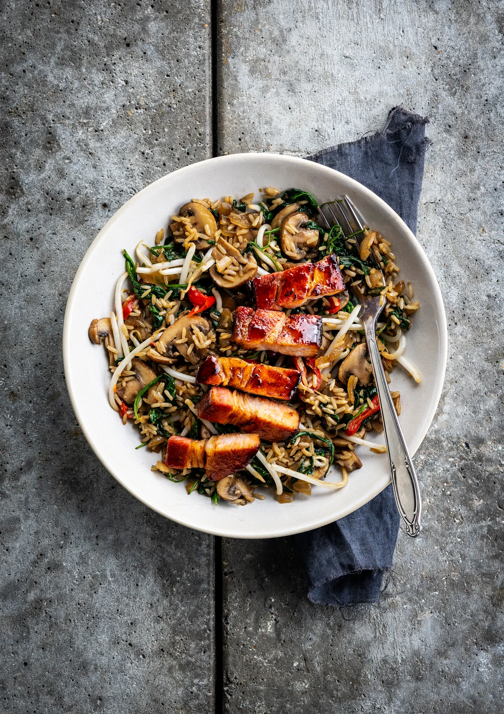

Poitrine de lard laquée et riz au miso, champignons châtaigne et sauce sriracha. Prêt en 35 minutes.

## Ingrédients (2 personnes)
- 1/2 gingembre
- 125 gr riz complet
- 100 gr germes de soja
- 1 oignon jaune
- 1/3 sachet de pâte de miso
- 1 gousse d'ail
- 1/2 piment rouge
- 2 càc de sauce sriracha
- 50 gr épinards
- 1 1/2 càs de sauce soja
- 100 gr lard cuit lentement (porc)
- 250 gr champignons blonds
- 1 càs de sucre brun
- huile
- beurre

## Préparation
1. Hachez finement l'oignon. Pressez l'ail et hachez le piment finement. Râpez le gingembre jusqu'à ce que vous ayez environ 1/2 càc par personne. Coupez les champignons en tranches.

2. Chauffez un filet d'huile (de sésame) et une noix de beurre dans une grande poêle et faites revenir les oignons, l'ail, le piment, le gingembre et les champignons pendant 3 min à feu moyen, jusqu'à ce que les oignons soient translucides et que les champignons soient dorés. Ajoutez le riz et faites-le cuire 1 min. Ajoutez la pâte de miso et déglacez avec 100 ml d'eau par personne. Laissez mijoter 25-30 min, jusqu'à ce que le riz soit cuit. Ajoutez de l'eau supplémentaire si elle s'évapore trop rapidement.

3. Incorporez les épinards, poignée par poignée, au riz lors des dernières minutes de cuisson et laissez réduire. Ajoutez également les germes de soja.

4. Mélangez la sauce soja avec la sauce sriracha et le sucre (brun) pour le laquage (voir astuce). Chauffez un filet d'huile dans une poêle à feu vif. Faites dorer le lard de tous les côtés (il est déjà cuit). Versez ou étalez le laquage sur le lard et faites cuire encore 1 min. Coupez-le ensuite en tranches.

5. Servez le riz au miso avec les tranches de lard. Bon appétit !

## Astuce
Si besoin, ajoutez un filet d’eau : le laquage s’étalera plus facilement.

## Lien
[Foodbag](https://www.foodbag.be/fr/recept?dishId=a0MJv00000IY2zVMAT&weekDocId=W46Y2026)
