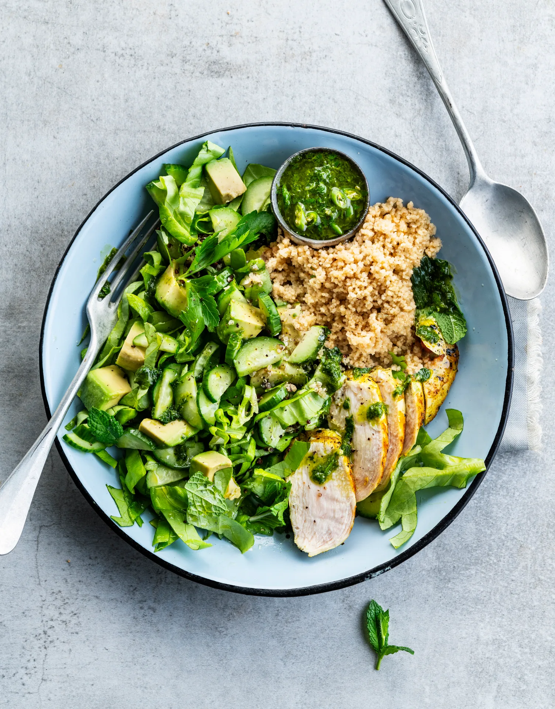

Poulet grillé au couscous, avocat, concombre et chimichurri. Prêt en 30 minutes.

## Ingrédients (2 personnes)
- 1 avocat
- 1/2 piment vert
- 1 gousse d'ail
- 2 filets de poulet
- 1/2 salade
- 2/3 paquet de persil & menthe
- 125 gr couscous complet
- 1 concombre
- 1 càs de vinaigre de vin rouge
- 1 càs de curcuma
- huile d'olive
- sel et poivre noir

## Préparation
1. Faites mariner le poulet avec du curcuma, un filet d’huile d’olive, du sel et du poivre noir.

2. Portez 70 ml d’eau par personne à ébullition. Couvrez le couscous d’eau bouillante et laissez-le reposer pendant 10 min à couvert. Égrenez ensuite les grains avec une fourchette, assaisonnez de sel, de poivre noir et d’huile d’olive.

3. Chimichurri : retirez les graines du piment et coupez-le en gros morceaux (voir astuce). À l’aide d’un mixeur plongeant ou d’un blender, mixez le persil, la menthe, l’ail (pelé), le piment, un généreux filet d’huile d’olive et le vinaigre de vin rouge jusqu’à obtenir un mélange homogène. Si nécessaire, ajoutez un filet d’eau pour obtenir une sauce plus lisse.

4. Salade : coupez la salade en lamelles. Coupez le concombre en demi-tranches et la chair de l'avocat en petits morceaux. Mélangez délicatement et assaisonnez avec un filet d’huile d’olive, un filet de chimichurri, du sel et du poivre noir.

5. Faites chauffer une poêle (à griller). Faites griller le poulet mariné pendant 7-8 min jusqu'à ce qu'il soit cuit. Coupez-le ensuite en lamelles.

6. Servez le couscous avec la salade et le poulet. Arrosez du reste du chimichurri. Bon appétit !

## Astuce
Vous aimez quand ça pique ? Ne retirez pas les graines du piment.

## Lien
[Foodbag](https://www.foodbag.be/fr/recept?dishId=a0MJv0000086CjRMAU&weekDocId=W34Y2026)
