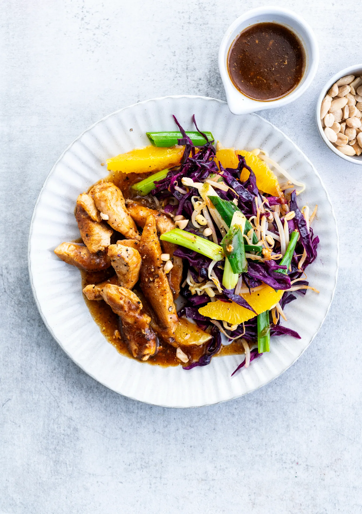

Poulet teriyaki à l’orange, chou rouge et germes de soja. Prêt en 30 minutes.

## Ingrédients (2 personnes)
- 3 tiges d'oignon nouveau
- 1 orange
- 1 gousse d'ail
- 1 gingembre
- 3 càs de sauce soja
- 1 càc de miel liquide
- 2 filets de poulet
- 25 gr raisins secs
- 150 gr germes de soja
- 25 gr cacahuètes
- 1/2 chou rouge
- huile d'olive
- 40 ml vinaigre de vin blanc
- sel et poivre noir

## Préparation
1. Faites tremper les raisins secs 5 à 10 min dans de l'eau chaude.

2. Râpez le gingembre jusqu'à obtenir environ 1 cuillère à café par personne et pressez l'ail. Coupez les oignons nouveaux en morceaux de 4 cm. Coupez le chou rouge en fines lamelles (comptez environ 150-200 g par personne).

3. Sauce teriyaki : avec un mixeur plongeant ou un blender, mixez les raisins secs (égouttés), la sauce soja, le miel, la moitié du vinaigre de vin blanc, l'ail et le gingembre.

4. Coupez le poulet en lanières. Faites chauffer un filet d'huile d'olive dans une poêle profonde à feu moyen et faites dorer le poulet (le poulet ne doit pas être complètement cuit). Ajoutez ensuite la sauce teriyaki et 100 ml d'eau, et portez le tout à ébullition (voir astuce). Laissez mijoter environ 8-12 min à feu doux, jusqu'à ce que la sauce ait épaissi et adhère au poulet. Ajoutez éventuellement selon votre goût un peu de poivre noir et de vinaigre de vin blanc.

5. Pelez l’orange à vif : coupez d’abord le haut et le bas de l'orange, puis retirez le reste de la peau. Glissez ensuite la lame de votre couteau entre les membranes blanches pour détacher les quartiers. Récupérez le jus.

6. Faites revenir le chou rouge avec les germes de soja et les morceaux d'oignon nouveau dans une poêle (wok) jusqu'à ce qu'ils soient al dente. Ajoutez les quartiers d'orange, le jus et le reste du vinaigre de vin blanc. Assaisonnez d'une bonne pincée de sel et de poivre noir. Hachez grossièrement les cacahuètes.

7. Servez les légumes avec le poulet à la sauce teriyaki. Terminez avec les cacahuètes. Bon appétit !

## Astuce
Ajoutez un peu d'eau si vous souhaitez plus de sauce.

## Lien
[Foodbag](https://www.foodbag.be/fr/recept?dishId=a0M1n000018Ax0NEAS&weekDocId=W46Y2026)
