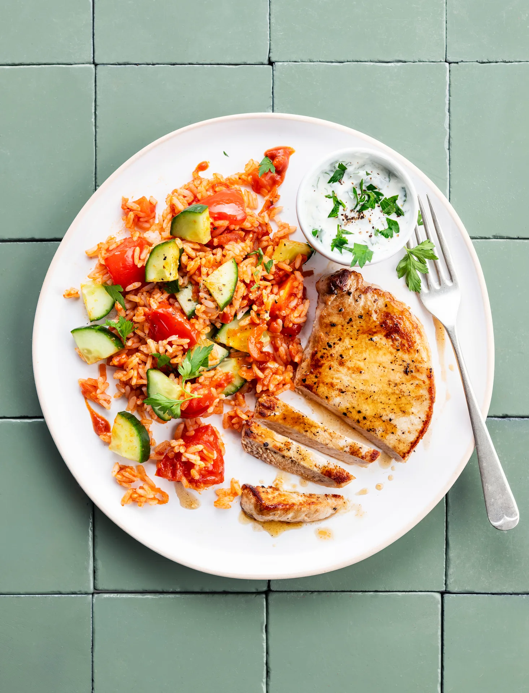

Riz shawarma et escalope de porc, concombre, tomates et yaourt à l’ail. Prêt en 30 minutes.

## Ingrédients (2 personnes)
- 1 gousse d'ail
- 3/4 sachet d'épices shawarma
- 1 concombre
- 1/2 oignon rouge
- 125 gr yaourt entier
- 3/4 plant de persil plat
- 1/2 boîte de concentré de tomates
- 2 tomates
- 2 escalopes de porc
- 125 gr riz blanc basmati
- 1 filet de vinaigre de vin blanc
- huile d'olive
- beurre
- sel et poivre noir

## Préparation
1. Faites cuire le riz selon les instructions figurant sur l’emballage.

2. Écrasez l'ail et coupez l'oignon en fines demi-rondelles. Coupez les tomates en quartiers et le concombre en fines tranches. Hachez le persil finement.

3. Yaourt à l'ail : incorporez la moitié de l'ail et le persil au yaourt. Ajoutez le vinaigre de vin blanc et un filet d'huile d'olive. Assaisonnez de sel et de poivre noir.

4. Faites chauffer un filet d’huile d’olive dans une grande poêle et faites revenir l’oignon, le concentré de tomate et le reste de l’ail pendant 2-3 min à feu doux. Ajoutez les morceaux de tomate et faites cuire pendant 4-5 min à feu doux. Versez 1 càs d'eau par personne et assaisonnez avec les épices shawarma, du sel et du poivre noir. Laissez mijoter pendant encore 5 min.

5. Pendant ce temps, faites chauffer un filet d’huile d’olive dans une autre poêle à feu vif. Assaisonnez les escalopes de porc de sel et de poivre noir. Faites revenir pendant 2-3 min des deux côtés, jusqu’à ce que la viande soit bien rosée. Facultatif : ajoutez à la fin une noix de beurre et laissez frémir pour relever la saveur. Vous préférez une viande un peu plus cuite ? Laissez-la une minute de plus dans la poêle.

6. Mélangez le riz et les tranches de concombre avec la préparation tomatée. Goûtez et, si nécessaire, salez et poivrez (voir astuce).

7. Servez le riz shawarma avec les escalopes de porc et le yaourt à l'ail. Bon appétit !

## Astuce
Vous aimez quand ça pique ? Assaisonnez le riz de flocons de piment ou de sauce sriracha.

## Lien
[Foodbag](https://www.foodbag.be/fr/recept?dishId=a0MJv000008tE8zMAE&weekDocId=W34Y2026)
