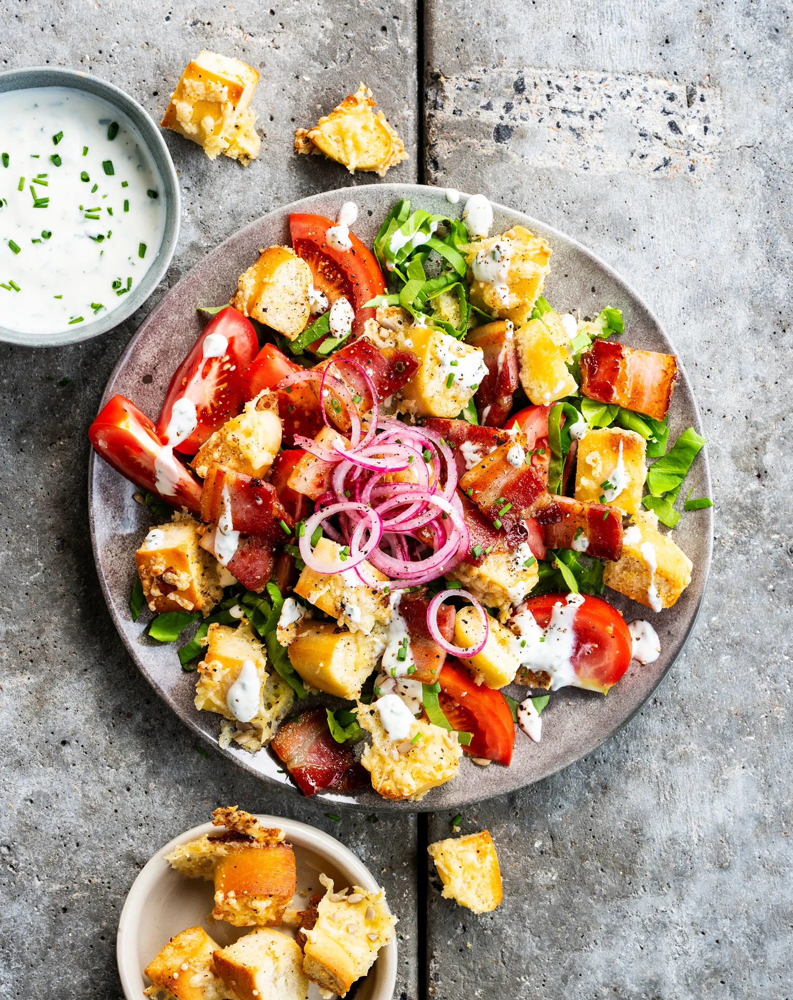

Salade BLT au lard et aux croutons, tomate et sauce au yaourt à l'ail. Prêt en 30 minutes.

## Ingrédients (2 personnes)
- 1 gousse d'ail
- 1/2 citron
- 35 gr fromage râpé
- 1 yaourt entier
- 1/2 plant de ciboulette
- 25 gr graines de tournesol
- 2/3 oignon rouge
- 2 tomates
- 4 pains panini
- 100 gr lard cuit lentement (porc)
- 2/3 salade
- huile d'olive
- 1 càs de vinaigre de vin blanc
- 1 pincée de sucre
- miel/sirop végétal (facultatif)
- papier sulfurisé
- sel et poivre noir

## Préparation
1. Préchauffez le four à 200°C et recouvrez une plaque de cuisson avec du papier sulfurisé.

2. Coupez les tomates en petits morceaux. Coupez la salade en fines lanières. Pressez l'ail, pressez le citron et hachez la ciboulette. Coupez l'oignon rouge en fines rondelles.

3. Pickles d'oignon : mélangez les rondelles d'oignon avec la quantité indiquée de vinaigre de vin blanc (voir astuce), une pincée de sucre et de sel. Malaxez bien avec vos mains et laissez mariner.

4. Sauce au yaourt : mélangez le yaourt avec le jus de citron, la ciboulette et la moitié de l'ail. Assaisonnez avec un filet d'huile d'olive, du sel et du poivre noir.

5. Coupez les pains panini en dés de 2 cm. Mélangez sur la plaque de cuisson avec un filet d'huile d'olive, le reste de l'ail, du sel et du poivre noir. Saupoudrez de fromage râpé par-dessus et mélangez bien, pour que le fromage adhère aux croutons. Glissez les croutons au four environ 5-7 min, jusqu'à ce que le fromage forme une croûte dorée. Saupoudrez les graines de tournesol par-dessus lors des dernières 2 min de cuisson.

6. Pendant ce temps, coupez le lard en lanières et faites-le rissoler dans une poêle sans matière grasse sur feu moyen, jusqu'à ce qu'il soit croustillant.  Éteignez le feu et arrosez de miel (facultatif) par-dessus.

7. Mélangez la salade, les morceaux de tomate, le lard, les croutons au fromage et les graines de tournesol. Arrosez de sauce au yaourt et terminez avec les pickles d'oignon. Bon appétit !

## Astuce
Versez quelques gouttes du vinaigre des oignons marinés sur la salade pour lui apporter une note acidulée.

## Lien
[Foodbag](https://www.foodbag.be/fr/recept?dishId=a0MJv00000HQ36vMAD&weekDocId=W38Y2026)
