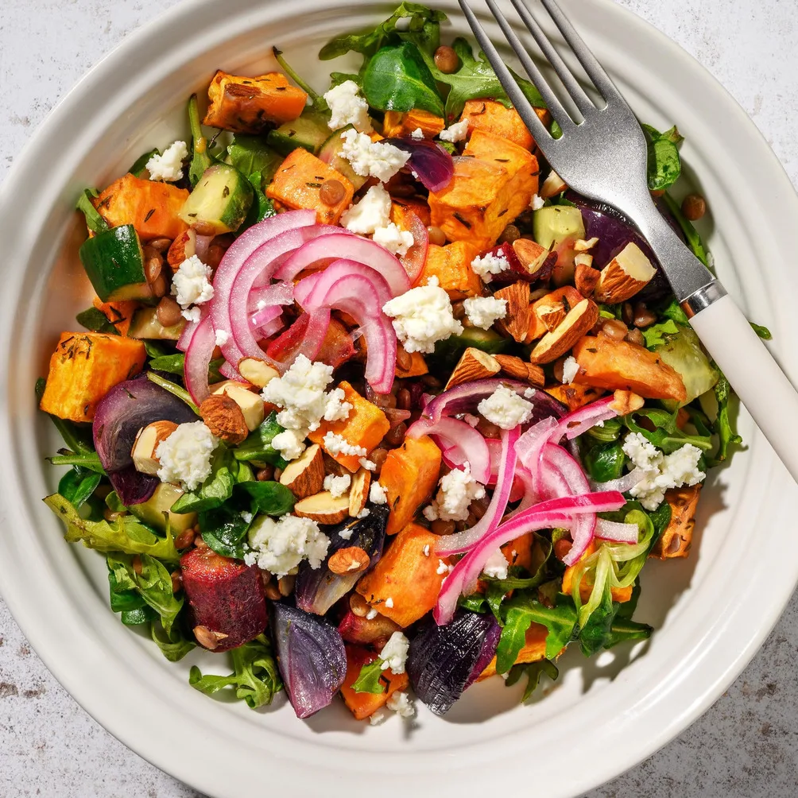
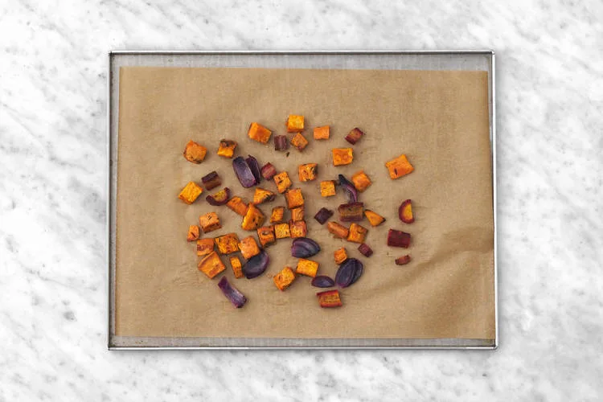
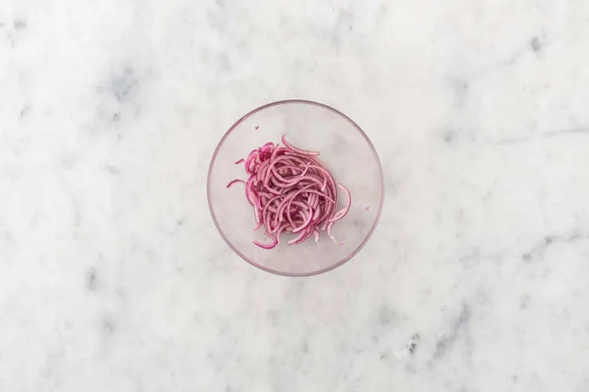
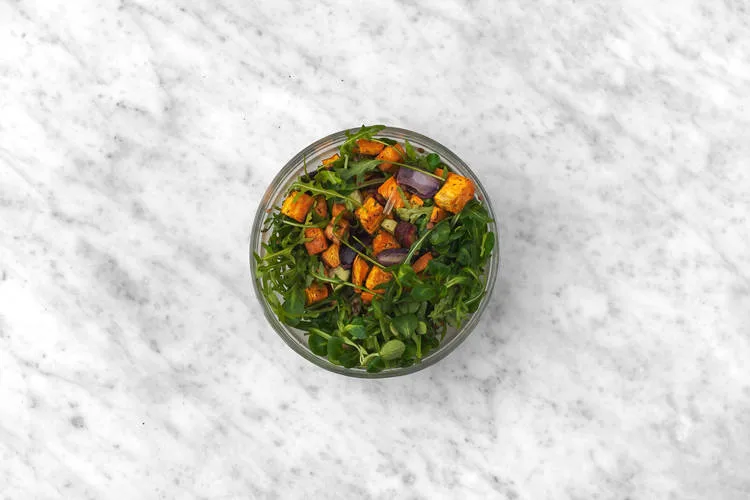
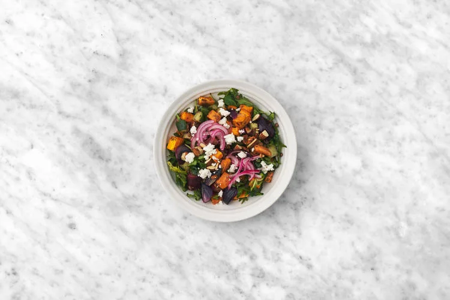

Fromage de chèvre sur salade de lentilles et vinaigrette aux cranberries, patate douce rôtie, oignon mariné et amandes salées. Prêt en 25 minutes.

Les lentilles sont une véritable mine d'or nutritionnelle ! Elles ne contiennent ni cholestérol ni sodium et sont riches en potassium, fer, fibres et protéines végétales. À portion égale, elles vous fournissent près de la moitié des protéines contenues dans la viande de porc.

## Ingrédients (2 personnes)
- 1 paquet de lentilles
- 300 gr patate douce
- 1 carotte violette
- 1 oignon rouge
- 1 sachet de thym séché
- 1 mini-concombre
- 60 gr roquette et mâche
- 40 gr chutney de cranberries
- 30 gr amandes grillées et salées
- 50 gr fromage de chèvre frais
- 1 cuillère à soupe d'huile d'olive
- 1 cuillère à soupe d'huile d'olive vierge extra
- 2 cuillères à soupe de vinaigre balsamique blanc
- 1 cuillère à café de sucre
- 1 cuillère à café de moutarde
- poivre et sel

## Préparation
1. Préchauffez le four à 200°C. Épluchez ou lavez bien la patate douce et la carotte, puis taillez-les en dés de 1 cm. Dispersez-les sur la plaque de cuisson recouverte de papier sulfurisé. Coupez la moitié de l'oignon en quartiers et ajoutez-les à la plaque de cuisson. Arrosez de l'huile d'olive et parsemez de thym. Salez et poivrez. Enfournez 13 à 15 minutes ou jusqu'à ce que les légumes soient cuits.

   

2. Coupez le reste de l'oignon en demi-rondelles. Dans le bol, mélangez le sucre avec la moitié du vinaigre balsamique blanc. Ajoutez-y l'oignon et 1 pincée de sel, puis mélangez bien. **Le saviez-vous ?** *L'oignon renferme des bienfaits souvent méconnus ! Il est en effet riche en fibres, vitamines B, mais aussi en antioxydants et vitamine C.*

   

3. Dans le saladier, mélangez le chutney de cranberries, l'huile d'olive vierge extra, la moutarde et le reste de vinaigre balsamique blanc. Salez et poivrez à votre goût. Taillez le concombre en dés et hachez grossièrement les amandes. Égouttez les lentilles. Ajoutez la salade, les lentilles, le concombre et les légumes rôtis au saladier. Mélangez bien avec la vinaigrette.

   

4. Servez la salade dans les assiettes creuses et déposez-y le fromage de chèvre. Garnissez de l'oignon mariné et des amandes.

   

## Lien
[HelloFresh](https://www.hellofresh.be/recipes/veggie-quick-25-min-lentils-potato-try-to-use-eid-hazelnuts-671b96baf9c856efe5000021?locale=fr-BE)
