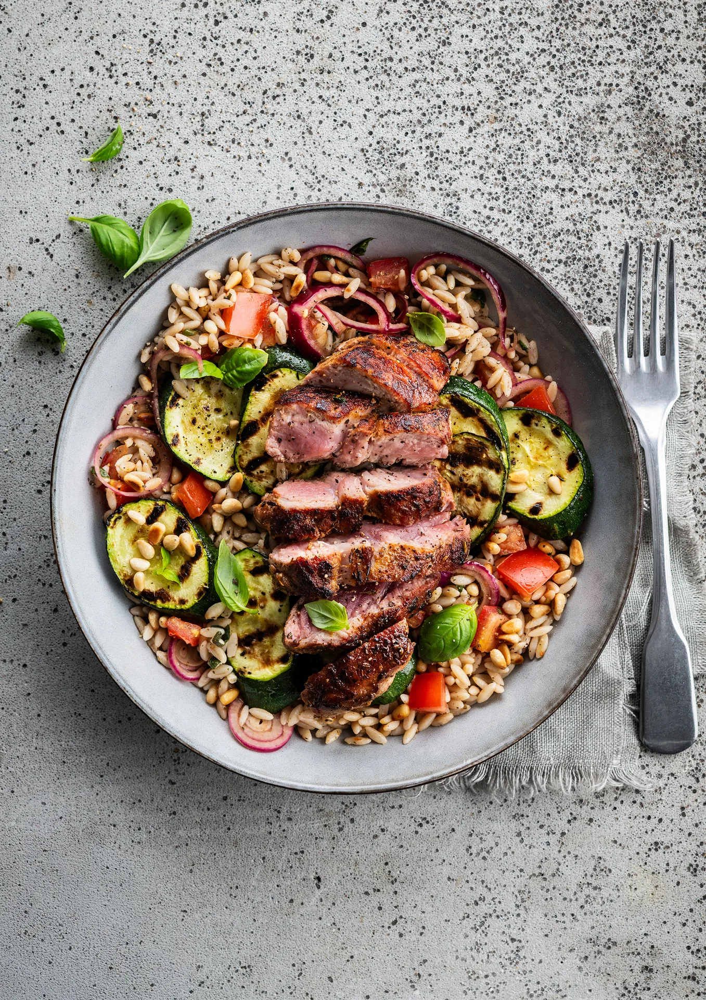

Salade de pâtes et spiringue de porc, courgette grillée et tomate. Prêt en 30 minutes.

## Ingrédients (2 personnes)
- 2 éperlans de porc marinés
- 125 gr orzo complet
- 1 courgette
- 2 tomates
- 15 gr pignons de pin
- 1/2 sachet de bruschetta rosso
- 1/2 oignon rouge
- 1 paquet de basilic
- huile d'olive
- 1 càs de vinaigre balsamique
- sel et poivre noir

## Préparation
1. Portez une casserole d’eau salée à ébullition pour l’orzo.

2. Coupez la courgette en tranches de 0,5 cm, arrosez d'huile d'olive et assaisonnez de sel et de poivre noir. Coupez les tomates en dés de 1 cm. Coupez l'oignon en rondelles aussi fines que possible (par exemple à l'aide d'une mandoline). Mélangez les rondelles d'oignon avec le vinaigre balsamique et une pincée de sel. Laissez mariner. Hachez grossièrement le basilic, gardez quelques feuilles pour la finition.

3. Faites rôtir les pignons de pin dans une poêle sans matière grasse (voir astuce).

4. Faites cuire l’orzo selon les instructions figurant sur l'emballage. Rincez à l'eau tiède et laissez bien égoutter.

5. Faites chauffer une poêle (à griller). Faites griller les tranches de courgette 2-3 min de chaque côté, jusqu'à ce qu'elles présentent de jolies marques de grillade. Retirez de la poêle.

6. Faites ensuite cuire les spiringues dans la poêle (gril). Comptez 3-4 min de chaque côté à feu vif. Assaisonnez de sel et de poivre noir.

7. Mélangez l'orzo avec les épices bruschetta rosso, les dés de tomate, les tranches de courgette grillée, les pignons de pin, les rondelles d'oignon et le basilic. Goûtez et assaisonnez avec un filet d’huile d’olive, du sel et du poivre noir. Coupez la viande en lanières. Servez la salade de pâtes (tiède) avec le spiringue et terminez avec les feuilles de basilic que vous avez mises de côté. Bon appétit !

## Astuce
Faire rôtir les pignons de pin est facultatif, mais je trouve que cela rehausse vraiment la saveur. Il suffit ensuite d'essuyer la poêle avec du papier absorbant, il n’y a pas de vaisselle en plus !

## Lien
[Foodbag](https://www.foodbag.be/fr/recept?dishId=a0MJv00000EIplZMAT&weekDocId=W38Y2026)
