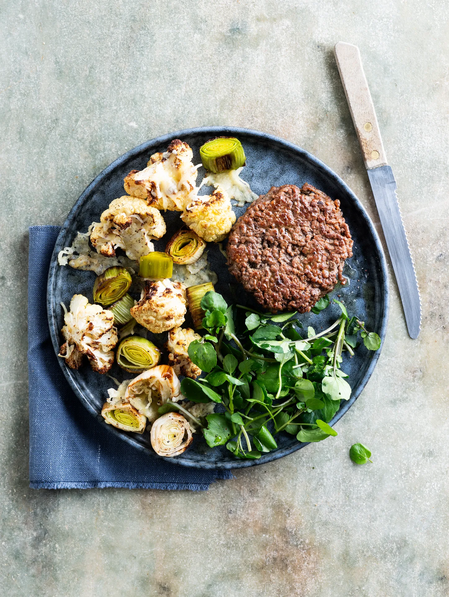

Steak haché au chou-fleur gratiné et cresson de jardin. Prêt en 30 minutes.

## Ingrédients (2 personnes)
- 1/2 chou-fleur
- 300 gr haché de boeuf
- 50 gr fromage râpé
- 50 gr cresson
- 1 poireau
- 1 pincée de noix de muscade
- 1 filet de vinaigre de vin blanc
- huile d'olive
- beurre
- sel et poivre noir

## Préparation
1. Sortez la viande du réfrigérateur pour la porter à température ambiante. Préchauffez le four à 180°C.

2. Coupez le chou-fleur en bouquets et le poireau en rondelles. Mélangez dans un plat à four avec de l'huile d'olive, du sel, du poivre noir et de la noix de muscade. Faites rôtir pendant 20 min dans le four.

3. Formez 1 steak haché par personne (voir astuce). Ne malaxez pas la viande. Plus vous-la manipulez, moins le burger sera aéré et juteux.

4. Assaisonnez le cresson avec un filet de vinaigre de vin blanc, du sel et du poivre noir.

5. Chauffez une poêle avec une belle noisette de beurre à feu moyen à vif. Attendez que le beurre grésille. Faites cuire les steaks hachés 2-3 min d'un côté. Retournez la viande et assaisonnez le côté cuit avec du sel et du poivre noir. Faites cuire l'autre côté encore 2-3 min. Retirez de la poêle et laissez reposer 1-2 min.

6. Pendant ce temps, parsemez le fromage râpé sur les légumes rôtis et remettez-les pendant 5 min dans le four, de préférence en mode grill.

7. Servez chaque steak haché avec les légumes rôtis et le cresson.

## Astuce
Faites un petit creux au centre avec votre doigt pour que le burger ne gonfle pas à la cuisson. Assaisonnez-le seulement pendant la cuisson, et non à l'avance car le sel absorbe l'humidité et assèche le burger.

## Lien
[Foodbag](https://www.foodbag.be/fr/recept?dishId=a0MJv00000HhLLxMAN&weekDocId=W40Y2026)
