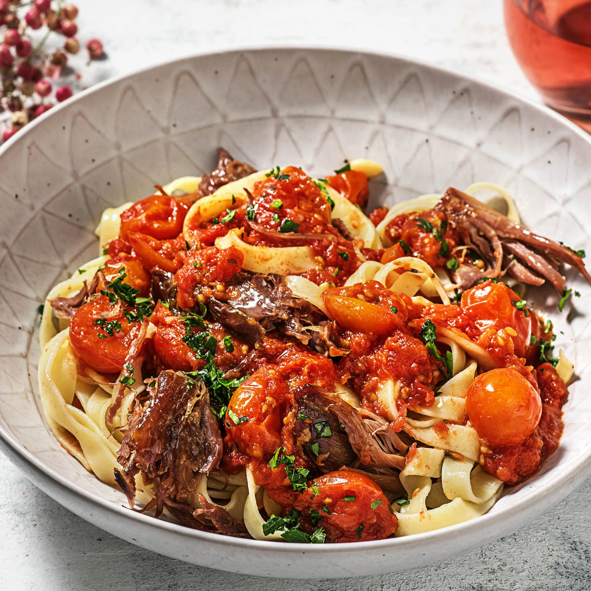
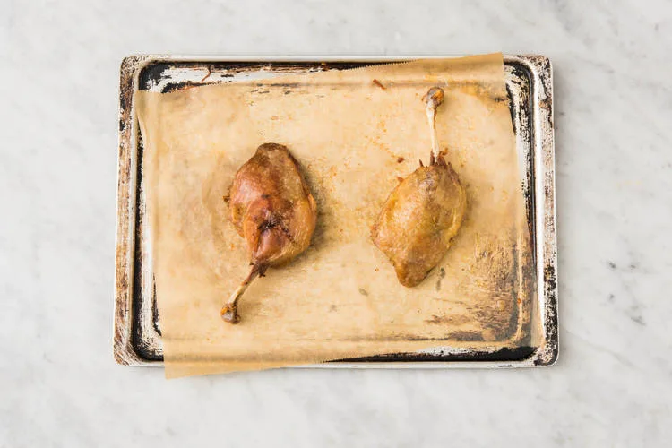
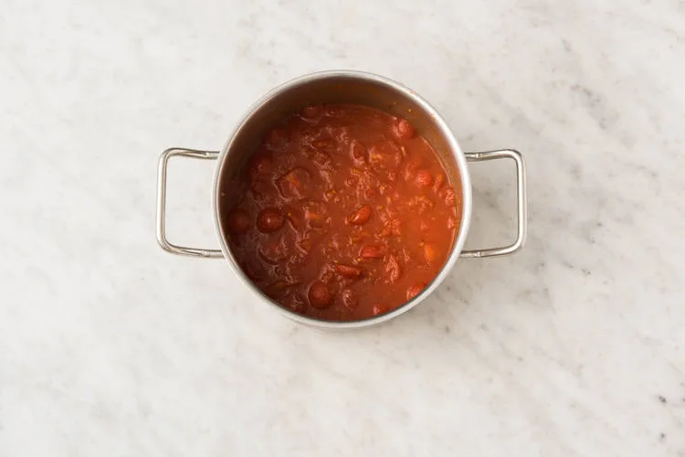
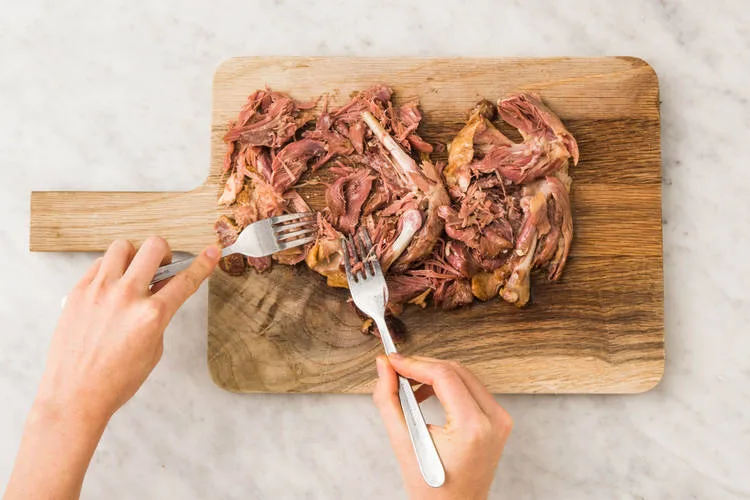

Tagliatelle au ragù de canard confit, accompagnées de roquette. Prêt en 55 minutes.

Le ragù est une sauce italienne à base de viande ou de volaille qui mijote longtemps pour que les saveurs pénètrent bien. Dans cette recette, vous allez utiliser du canard confit, ajouté au dernier moment. Confit — c’est-à-dire cuit lentement dans sa graisse —, le canard est extrêmement savoureux. Et le goût sucré du vinaigre balsamique apporte de la profondeur à la sauce.

## Ingrédients (2 personnes)
- 2 confits de canard
- 1 gousse d'ail
- 1 échalote
- 250 gr tomates cerises rouges
- 2/3 boîte de cubes de tomates
- 8 bouquets de persil plat frais
- 180 gr tagliatelle
- 10 gr pignons de pin
- 60 gr roquette
- 1 cuillère à soupe de vinaigre balsamique noir
- 1/2 cuillère à café de sucre
- 1/2 cube de bouillon de volaille
- 1 1/2 cuillère à soupe d'huile d'olive vierge extra
- 1 1/2 cuillère à café de vinaigre de vin blanc
- 2 cuillères à soupe de beurre
- poivre et sel

## Préparation
1. Préchauffez le four à 200 degrés. Disposez la cuisse de canard confite sur la plaque recouverte de papier sulfurisé. Enfournez 20 à 22 minutes. Laissez ensuite refroidir jusqu’à pouvoir la toucher sans vous brûler les doigts.

   

2. Pendant ce temps, émincez ou écrasez l’ail. Émincez l’échalote et coupez les tomates cerises en deux. Dans la petite casserole, faites chauffer le beurre à feu moyen et faites-y revenir l’ail et l’échalote 2 minutes avec une pincée de sel. Portez le feu à moyen-vif, ajoutez les tomates et faites-les sauter 2 minutes. Arrosez avec le vinaigre balsamique et réchauffez 4 à 5 minutes, jusqu’à ce que la majeure partie de l’eau se soit évaporée.

   

3. Ajoutez les tomates pelées et le sucre à la petite casserole et émincez ¼ de cube de bouillon par personne au-dessus. Portez à ébullition, puis baissez le feu sur moyen-doux. Laissez mijoter 20 minutes. Remuez régulièrement. Pendant ce temps, hachez grossièrement le persil.

   

4. Portez une grande quantité d’eau à ébullition dans la casserole. Ajoutez les tagliatelle et faites cuire 12 à 14 minutes à couvert. Égouttez, ajoutez la moitié de l’huile d’olive vierge extra, puis salez et poivrez. Pendant ce temps, faites chauffer la poêle à feu moyen-vif et faites dorer les pignons de pin à sec.

   

5. Dans le saladier, préparez la vinaigrette en mélangeant le vinaigre de vin blanc et le reste d’huile d’olive vierge extra. Salez et poivrez. Mélangez la roquette à la vinaigrette et garnissez avec les pignons de pin.

   

6. Effilochez la viande de la cuisse de canard à l’aide d’une fourchette. Ajoutez-la à la sauce tomate, puis remuez bien. Servez les tagliatelle dans les assiettes et versez la sauce par-dessus. Garnissez de persil plat et accompagnez de la salade.

   

## Lien
[HelloFresh](https://www.hellofresh.be/recipes/tagliatelle-au-ragu-de-canard-confit-5c3f45e8c445fa483b13e192?locale=fr-BE)
