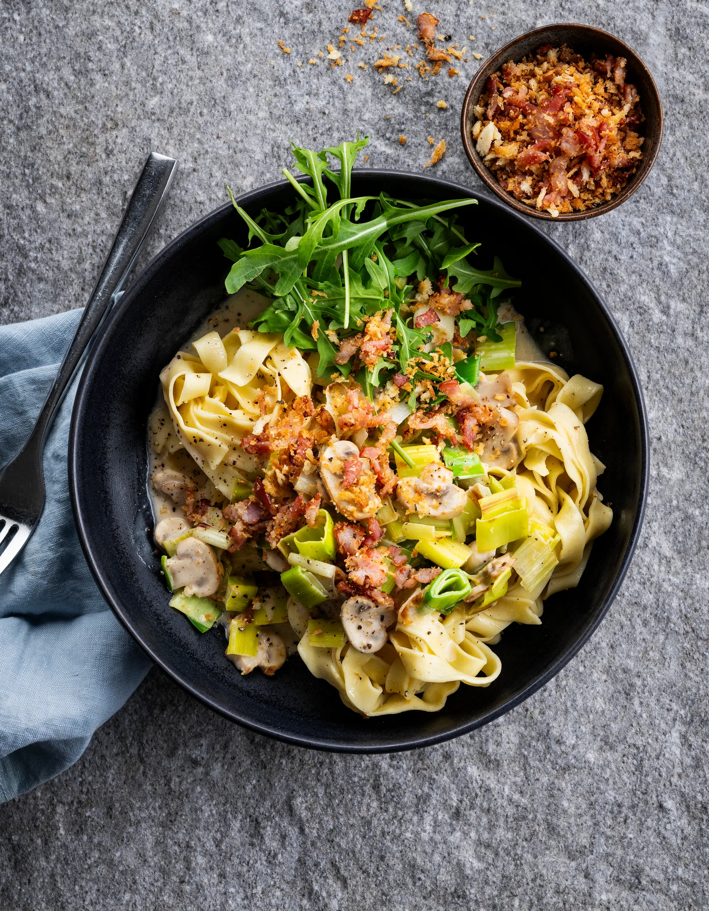

Tagliatelles crémeuses au poireau, champignons et crumble lard-panko. Prêt en 25 minutes.

## Ingrédients (2 personnes)
- 250 gr tagliatelles fraîches
- 2 poireaux
- 125 gr champignons blancs
- 150 ml crème (20% mg)
- 25 gr chapelure panko
- 50 gr roquette
- 4 tranches de lard fumé (porc)
- papier absorbant
- huile d'olive
- sel et poivre noir

## Préparation
1. Portez une grande casserole d’eau salée à ébullition pour les pâtes.

2. Coupez les poireaux en demi-rondelles de max. 1 cm. Coupez les champignons en fines tranches. Coupez le lard aussi finement que possible.

3. Crumble : faites chauffer une grande poêle sans matière grasse à feu moyen. Ajoutez le lard et faites revenir à feu moyen pendant 2 min. Ajoutez ensuite la chapelure panko et faites revenir jusqu'à ce qu'elle prenne une couleur dorée (voir astuce). Retirez de la poêle et égouttez sur du papier absorbant. Assaisonnez de sel et de poivre noir.

4. Faites chauffer un filet d’huile d’olive dans la poêle du crumble. Faites revenir les champignons et les poireaux pendant 5-8 min jusqu'à ce qu'ils soient cuits (n’hésitez pas à faire cuire les légumes en deux fois si votre poêle est trop petite). Déglacez avec la crème épaisse et assaisonnez de sel et de poivre noir. Laissez mijoter à feu doux jusqu'à ce que les pâtes soient prêtes.

5. Faites cuire les pâtes pendant 2 min environ jusqu’à ce qu’elles soient al dente. Égouttez les pâtes, mais gardez une tasse de l’eau de cuisson.

6. Incorporez les pâtes aux légumes. Ajoutez éventuellement un peu d’eau de cuisson afin d’obtenir une sauce plus onctueuse.

7. Garnissez les pâtes avec le crumble lard-panko et une poignée de roquette. Bon appétit !

## Astuce
Le lard libère de la graisse dans laquelle vous pouvez faire cuire le panko. Il n'y a pas assez de matière grasse ? N’hésitez pas à ajouter un filet d’huile.

## Lien
[Foodbag](https://www.foodbag.be/fr/recept?dishId=a0MJv00000CFmiGMAT&weekDocId=W34Y2026)
