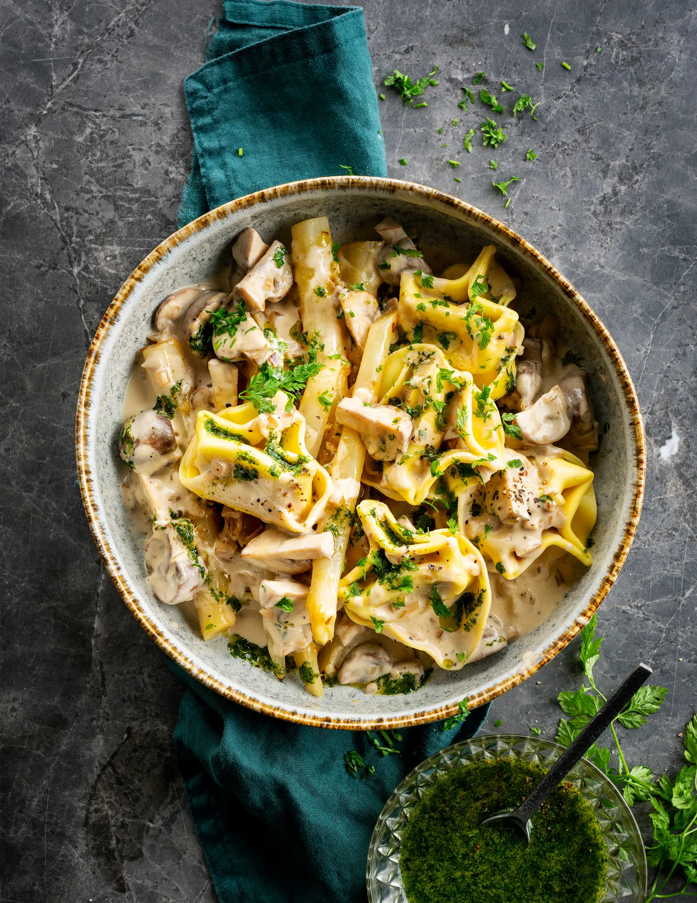

Tortellonis cacio e pepe et salsifis, champignons à la sauce au vin blanc. Prêt en 45 minutes.

## Ingrédients (2 personnes)
- 10 tortelloni frais cacio e pepe
- 500 gr salsifis
- 125 ml vin blanc
- 200 ml crème (20% mg)
- 1 citron
- 1/2 paquet d'estragon & cerfeuil
- 1 échalote
- 1/2 cube de bouillon de légumes
- 1 gousse d'ail
- 125 gr champignons châtaigne
- beurre
- 4 càs d'huile d'olive
- sel et poivre noir

## Préparation
1. Pressez la moitié du citron. Brosser les salsifis sous l'eau courante, et épluchez-les avec un éplucheur. Coupez les plus gros d'abord en deux dans le sens de la longueur et puis en morceaux de 4-5 cm (voir astuce). Disposez ensuite les salsifis dans un bol avec de l'eau et le jus de citron (ceci empêche leur décoloration).

2. Pendant ce temps, hachez l'échalote et l'ail. Faites chauffer un filet d'huile d'olive dans une poêle et faites revenir la moitié de l'ail et la moitié de l'échalote jusqu'à ce qu'elle soit translucide. Sortez les salsifis de l'eau citronnée et ajoutez-les dans la poêle. Faites revenir 2-3 min. Déglacez les légumes avec un filet d'eau de citron et émiettez le cube de bouillon par-dessus. Laissez mijoter à couvert 10-12 min jusqu'à ce que les salsifis soient al dente. Salez et poivrez.

3. Pendant ce temps, portez à ébullition une grande casserole d'eau salée pour les pâtes.

4. Champignons sauce au vin blanc : coupez les champignons en 4, les plus gros en 6. Faites fondre une noix de beurre dans une poêle et faites cuire les champignons 6-8 min à feu vif. Ajoutez le reste de l'échalote et de l'ail. Faites cuire 2 min de plus. Assaisonnez de sel, de poivre noir et d'un filet de jus de citron. Déglacez avec le vin blanc et laissez-le complètement s'évaporer. Ajoutez ensuite la crème et laissez mijoter 10 min sur feu doux.

5. Huile verte : effeuillez les brins d'estragon. Avec un mixeur plongeant ou un blender, mixez l'estragon et le cerfeuil (gardez quelques brins pour la finition). Ajoutez progressivement l'huile d'olive (comptez environ 2 càs par personne). Mixez pendant environ 5 min. Facultatif : mettez un morceau de papier absorbant dans une passoire et placez un bol dessous. Versez l'huile dans la passoire et laissez égoutter. Salez et poivrez.

6. Faites cuire les pâtes al dente, pendant environ 2 min. Coupez le reste du citron en quartiers.

7. Disposez les tortellonis dans une assiette creuse. Ajoutez les salsifis et les champignons et versez la sauce au vin blanc par-dessus. Terminez avec un peu d'huile verte, quelques brins de cerfeuil, un quartier de citron et un bon tour de moulin à poivre. Bon appétit !

## Astuce
Une astuce en or pour éplucher les salsifis ? Portez des gants car ils libèrent un liquide collant à l’épluchage.

## Lien
[Foodbag](https://www.foodbag.be/fr/recept?dishId=a0MJv00000C3ltFMAR&weekDocId=W46Y2026)
